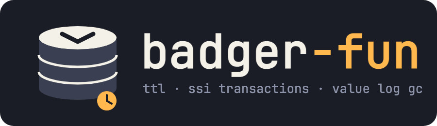
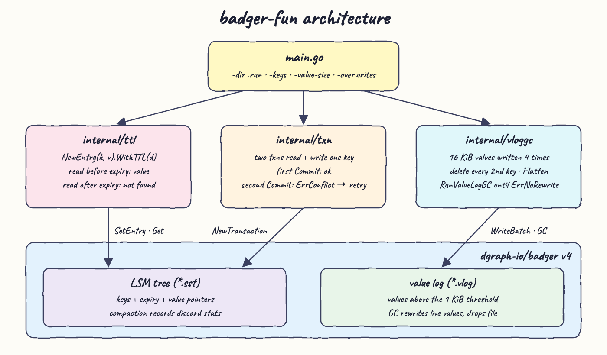

<p align="center"></p>

`badger-fun` is a small CLI that tries three [dgraph-io/badger v4](https://github.com/dgraph-io/badger) features: entries with a TTL that expire, read-write transactions that detect conflicts (`ErrConflict`), and a value log GC benchmark that shows how much disk space `RunValueLogGC` gets back. All data goes to `.run/`.

## How it Works

- `main.go` wipes `.run/kv` and `.run/gc`, then runs the three parts in order.
- **TTL:** `internal/ttl` writes `session:42` with `NewEntry(...).WithTTL(2s)` and `user:42` with no TTL. It reads both, waits 3 seconds, and reads again. The session is gone (`ErrKeyNotFound`, shown as "expired"). The user is still there.
- **Conflicts:** `internal/txn.Race` opens two read-write transactions at the same time. Each one reads a counter and writes `counter+1`. The first `Commit` works. The second gets `badger.ErrConflict`, because a key it read was changed after it started (SSI). With two different keys, both commits work. `IncrementWithRetry` then retries the lost increment in a new transaction.
- **Value log GC:** `internal/vloggc` opens a DB where values above 1 KiB go to the value log, and vlog files are 8 MiB. It writes 2,000 random 16 KiB values, overwrites each one 3 times, deletes every 2nd key, closes and reopens the DB, and calls `Flatten` so compaction records discard stats. It measures the size of the `*.vlog` files, calls `RunValueLogGC(0.5)` until `ErrNoRewrite`, and measures again. Finally it reads every live key back.

## Architecture



The [SVG source](assets/architecture.svg) uses the Caveat font, a wobble filter, pastel boxes and solid arrows.

## Features

- **TTL entries:** per-key expiry. Expired keys read as not found, and keys with no TTL never expire.
- **Conflict detection:** shows a real `ErrConflict` from two transactions that overlap, and the retry that fixes it.
- **Independent keys don't conflict:** two transactions on different keys both commit.
- **Value log GC benchmark:** vlog size and file count before and after, how much was reclaimed, the number of GC rewrites, and the time GC took.
- **Data check after GC:** every live key is read back at full size, and every deleted key must be gone.
- **Configurable:** `-keys`, `-value-size`, `-overwrites`, `-dir`.

## Stack

- **Go 1.26:** one binary, standard `flag`, `context` and `crypto/rand`.
- **dgraph-io/badger v4.9.6:** the library being explored. It is an LSM tree with a separate value log (WiscKey design).
- **Playwright (npx):** only used to render the SVGs into PNGs.

## Contracts

| Flag | Default | Meaning |
|---|---|---|
| `-dir` | `.run` | Data directory. `kv/` and `gc/` are wiped on every run |
| `-keys` | `2000` | Keys written by the GC benchmark |
| `-value-size` | `16384` | Value size in bytes |
| `-overwrites` | `3` | How many times every key is overwritten after the first write |

| Package | Public surface |
|---|---|
| `internal/ttl` | `Put(db, key, value, ttl) error`, `Read(db, key) (Reading, error)` |
| `internal/txn` | `Race(db, firstKey, secondKey) (Outcome, error)`, `IncrementWithRetry(db, key, attempts)`, `Counter(db, key)` |
| `internal/vloggc` | `Run(ctx, Config) (Report, error)`, `VlogSize(dir) (bytes, files, error)` |

## Key data structures and design decisions

- **`ttl.Reading{Found, Value, ExpiresAt}`:** a missing or expired key is `Found=false`, not an error, so callers don't have to check for `ErrKeyNotFound` themselves.
- **`txn.Outcome{First, Second error}`:** keeps the raw commit errors, so callers and tests use `errors.Is(err, badger.ErrConflict)`.
- **Conflicts come from reads:** badger only tracks keys that a transaction *read*. Each transaction reads the counter before writing it. Blind writes to the same key would both commit.
- **GC needs discard stats:** `RunValueLogGC` picks a vlog file based on the discard stats that compaction writes. Without compaction it returns `ErrNoRewrite` and gets nothing back. That is why the benchmark uses a small memtable (64 KiB), `NumLevelZeroTables=1`, close+reopen (flushes the memtable and truncates the active vlog to its real size) and `Flatten`. With default options the first try reclaimed 0 bytes.
- **Disk size comes from the files:** `VlogSize` adds up the `*.vlog` file sizes on disk instead of using `db.Size()`, because `db.Size()` is only refreshed from time to time.
- **The active vlog file is never collected:** that is why "after" stays above the live data (1,000 x 16 KiB = 15.6 MiB).

## How to run and test

```bash
./scripts/setup.sh
./scripts/run.sh
./scripts/run.sh -keys 5000 -value-size 32768
./scripts/test-all.sh
```

Tests use `t.TempDir()`:

- `internal/ttl`: an expired session reads as not found, an entry with no TTL survives the same wait, a missing key is not an error, and the stored expiry matches the TTL that was asked for.
- `internal/txn`: the same key gives `ErrConflict` on the second commit, different keys both commit, and a retry after a conflict gives counter 2.
- `internal/vloggc`: overwritten and deleted values are reclaimed with at least one rewrite and all live keys are kept. Data written once is never shrunk. A cancelled context stops the run.

## Results

Real output of `./scripts/run.sh` (Apple Silicon, macOS):

```
== TTL entries
  t=0s  session:42  "token-abc" expires in 1s
  t=0s  user:42     "ana" no ttl
  t=3s  session:42  expired, ErrKeyNotFound
  t=3s  user:42     "ana" no ttl
== Read-write transactions
  same key       txn1 commit: ok, txn2 commit: ErrConflict
  different keys txn1 commit: ok, txn2 commit: ok
  counter:a after conflict = 1
  counter:a after retry    = 2
== Value log GC
  2000 keys x 16 KiB values, written 4 times, every 2nd key deleted
  bytes written      125.0 MiB
  vlog before gc     141.2 MiB in 15 files
  vlog after gc      47.3 MiB in 5 files
  reclaimed          93.9 MiB (67%)
  gc rewrites        10
  gc time            41ms
  live keys verified 1000
```

`./scripts/test-all.sh`:

```
bash syntax
gofmt
go vet
unit tests
?   	github.com/diegopacheco/golang-playground/pocs/badger-fun	[no test files]
ok  	github.com/diegopacheco/golang-playground/pocs/badger-fun/internal/ttl	3.592s
ok  	github.com/diegopacheco/golang-playground/pocs/badger-fun/internal/txn	1.461s
ok  	github.com/diegopacheco/golang-playground/pocs/badger-fun/internal/vloggc	1.702s
building bin/badger-fun
smoke run
all tests passed
```

## Scripts

All scripts live in `scripts/` and work from any directory. This is a CLI with no services, so there are no start, stop or status scripts.

| Script | What it does |
|---|---|
| `./scripts/setup.sh` | Downloads Go modules and builds `bin/badger-fun` |
| `./scripts/run.sh` | Builds and runs the CLI with data in `.run/`. Extra flags are passed through |
| `./scripts/test-all.sh` | Bash syntax, gofmt, go vet, `go test -race`, build and a small smoke run |
