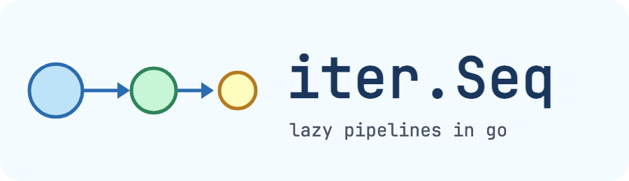
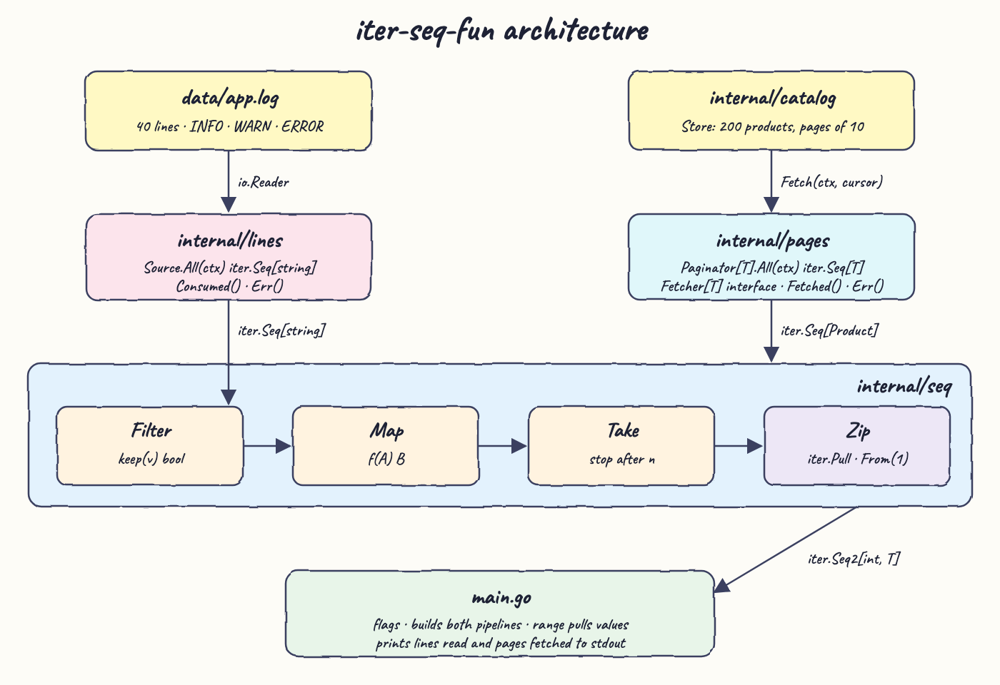

<p align="center"></p>

`iter-seq-fun` shows Go range-over-func iterators (`iter.Seq`, `iter.Seq2`, `iter.Pull`) building lazy `Filter -> Map -> Take` pipelines over two sources: the lines of a log file and a paginated product API. It prints how many lines were read and how many pages were fetched, to show that only the needed data is touched. Standard library only.

## How it Works?

- `internal/lines.Source` wraps a `bufio.Scanner` and exposes `All(ctx) iter.Seq[string]`. Every line is read only when the consumer asks for the next value.
- `internal/pages.Paginator[T]` walks a cursor-based API through a small `Fetcher[T]` interface and exposes `All(ctx) iter.Seq[T]`. The next page is fetched only when the current page runs out of items.
- `internal/catalog.Store` is an in-process fake paginated API (200 products, 10 per page) that counts its calls. No network is used.
- `internal/seq` has generic `Filter`, `Map`, `Take`, `From` and `Zip`. Each one wraps an `iter.Seq` and stops when `yield` returns false, so a `Take(3)` stops the whole chain back to the file or the API.
- `seq.Zip` turns both inputs into pull iterators with `iter.Pull`, advances them one step at a time, and calls both `stop` functions on exit so no coroutine is left running.
- `main.go` numbers each result by zipping the infinite `From(1)` counter with the pipeline, then prints `lines read` and `pages fetched`.
- Errors from the reader or the API are kept on the source (`Err()`), wrapped with `%w`, like `bufio.Scanner`.

## Architecture



The [SVG source](assets/architecture.svg) uses the Caveat font, a wobble filter, pastel boxes and solid arrows.

## Features

- **Lazy file pipeline:** `Filter(ERROR) -> Map(message) -> Take(n)` reads the log only up to the n-th match.
- **Lazy paginated pipeline:** `Filter(price) -> Map(label) -> Take(n)` fetches only the pages needed for n matches.
- **iter.Pull zip:** `Zip` pairs two push iterators by pulling them step by step, and stops at the shorter one.
- **Infinite sequences:** `From(1)` never ends; `Zip` and `Take` make it safe to use.
- **Context aware:** both sources check `ctx` and stop with a wrapped `context.Canceled`.
- **Error reporting:** IO and API errors are wrapped and can be checked with `errors.Is`.

## Stack

- **Go 1.26:** range-over-func, `iter` package and generic type parameters.
- **Go standard library only:** `iter`, `bufio`, `context`, `slices`, `flag`, `testing/iotest`.

## Contracts

`iter-seq-fun` is a CLI. It prints to stdout and exits non-zero on error.

| Flag | Default | What it does |
|---|---|---|
| `-file` | `data/app.log` | log file to scan |
| `-level` | `ERROR` | log level to keep |
| `-products` | `200` | products in the fake catalog |
| `-page-size` | `10` | products per page |
| `-max-cents` | `120` | keep products cheaper than this |
| `-take` | `3` | items to take from each pipeline |

Output: the numbered results of each pipeline, then `lines read: N` and `pages fetched: X of Y`.

Go API:

```go
func Filter[T any](s iter.Seq[T], keep func(T) bool) iter.Seq[T]
func Map[A, B any](s iter.Seq[A], f func(A) B) iter.Seq[B]
func Take[T any](s iter.Seq[T], n int) iter.Seq[T]
func From(start int) iter.Seq[int]
func Zip[A, B any](a iter.Seq[A], b iter.Seq[B]) iter.Seq2[A, B]

type Fetcher[T any] interface {
	Fetch(ctx context.Context, cursor string) (Page[T], error)
}
```

## Key data structures and design decisions

- **`Page[T]{Items, Next}`:** an empty `Next` ends pagination, so the paginator does not need to know the total count.
- **`Fetcher[T]` lives in `pages`, the consumer:** the catalog only has to have a matching `Fetch` method. Tests use a tiny map-based fake.
- **`Source` and `Paginator` keep `Err()` next to `All()`:** an `iter.Seq[T]` cannot return an error, so errors are kept like `bufio.Scanner` does. This keeps the pipeline types simple (`iter.Seq[T]` instead of `iter.Seq2[T, error]`).
- **Counters (`Consumed`, `Fetched`, `Calls`):** they exist so tests and the CLI can show that the pipelines are lazy.
- **`Zip` uses `iter.Pull` with `defer stop()`:** breaking out of the loop early still stops both coroutines.
- **The catalog rejects bad cursors with `ErrBadCursor`:** a broken cursor cannot make the paginator loop forever.

## How to run

```bash
scripts/setup.sh
scripts/run.sh
scripts/run.sh -take 5 -max-cents 150
```

## Tests

```bash
scripts/test-all.sh
```

It runs `bash -n` on every script, `gofmt`, `go vet`, `go test -race`, builds the binary and runs it once. The tests prove that the pipelines are lazy:

- `Take(1)` over a 10,000-line reader consumes exactly 10 lines when the first match is line 10.
- Items on page one never fetch page two; crossing a page boundary fetches exactly one more page.
- Zipping two paginated sources for 4 pairs fetches 2 pages per side, not all of them.
- Breaking out of `Zip` over an infinite `From(1)` releases the other pulled sequence.

## Results

`scripts/run.sh`:

```
building bin/iter-seq-fun
lines pipeline: Filter(ERROR) -> Map(message) -> Take(3)
  1. payment gateway timeout for order 7781
  2. inventory service returned 503
  3. invalid coupon code SAVE99 rejected
  lines read: 13 (stopped as soon as 3 matches were taken)

pages pipeline: Filter(price < 120 cents) -> Map(label) -> Take(3)
  1. product-049 $1.13
  2. product-073 $1.01
  3. product-122 $1.14
  pages fetched: 13 of 20
```

The log has 40 lines and the scan stopped at line 13. The catalog has 20 pages and only 13 were fetched.
