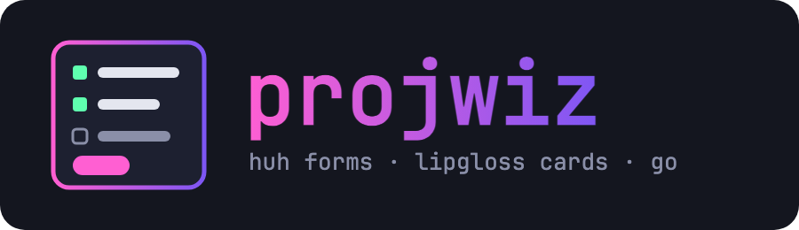
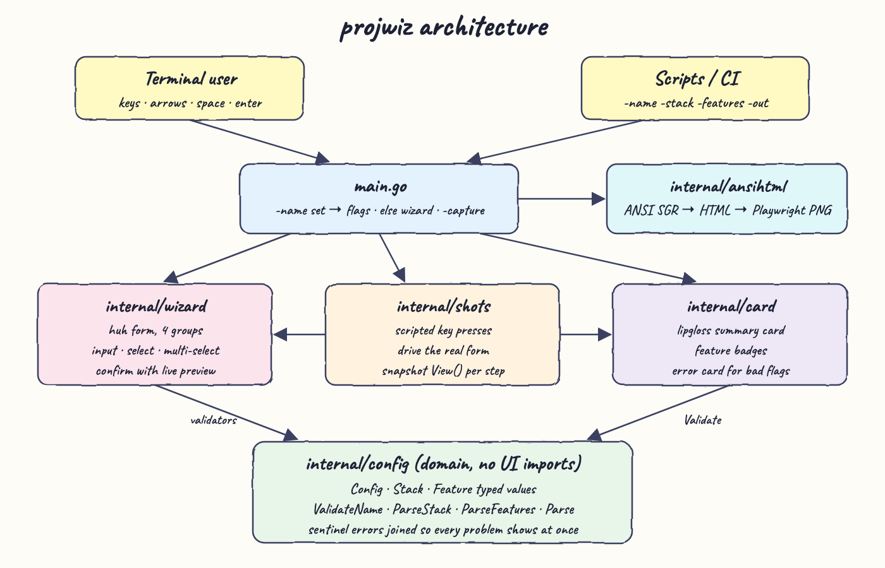
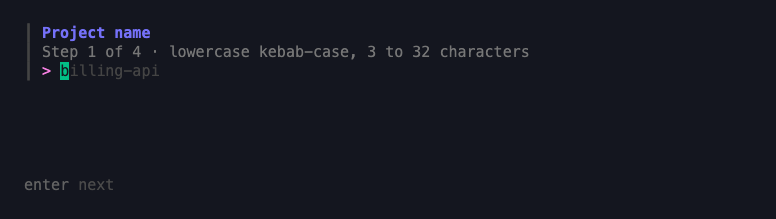
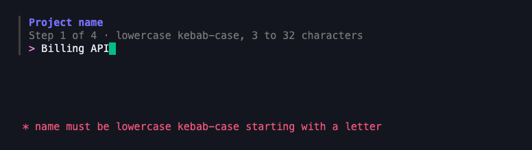
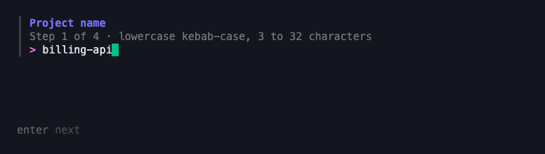
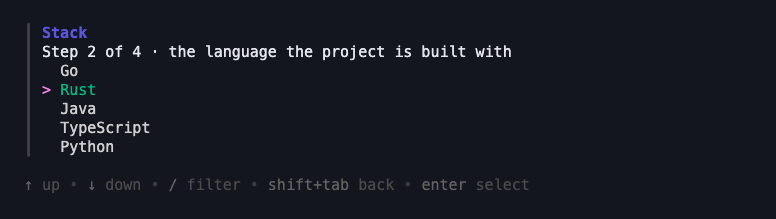
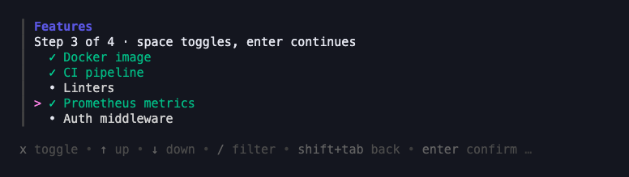
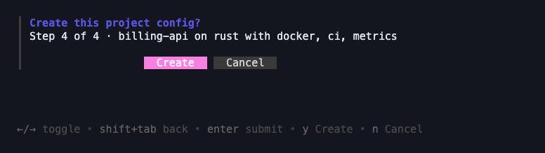
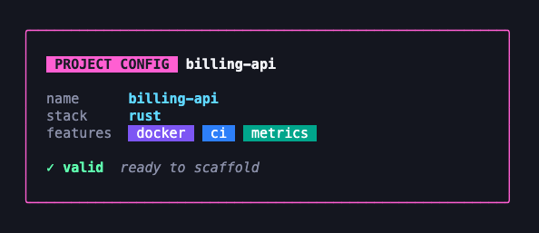
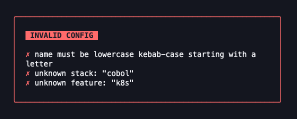

<p align="center"></p>

# lipgloss-huh-fun

`projwiz` is a multi-step CLI wizard that creates a project config. It asks for a project name (validated), a stack, a set of features and a confirmation using [huh](https://github.com/charmbracelet/huh) forms, then prints a summary card styled with [lipgloss](https://github.com/charmbracelet/lipgloss). The same config can be produced without a terminal through flags, so it works in scripts and CI.

## How it Works

1. `main.go` checks the flags: when `-name` is set it runs non-interactively, otherwise it opens the wizard.
2. `internal/wizard` builds one huh form with four groups, so each step is its own screen: name input, stack select, features multi-select, confirm.
3. Every field validates with functions from `internal/config`, so the wizard and the flags share exactly the same rules.
4. The confirm step shows a live preview of the answers through `DescriptionFunc`.
5. After confirmation the answers become a `config.Config`, are validated once more and rendered by `internal/card` as a lipgloss card.
6. In flag mode `config.Parse` joins every error with `errors.Join`, so a script sees all problems at once in a red error card and exits 1.
7. `-out FILE` writes the config as JSON.
8. `-capture DIR` drives the real huh form with scripted key presses (`internal/shots`), snapshots `View()` at every step and converts the ANSI output to HTML (`internal/ansihtml`); `scripts/printscreens.sh` turns those pages into PNGs with Playwright.

## Architecture



The [SVG source](assets/architecture.svg) uses the Caveat font, a wobble filter, pastel boxes and solid arrows.

## Features

- Four-step wizard: name, stack, features, confirm.
- Name validation while typing: lowercase kebab-case, 3 to 32 characters, letter first, no double or trailing dash, reserved names rejected.
- Stack select (Go, Rust, Java, TypeScript, Python) and features multi-select (docker, ci, lint, metrics, auth).
- Confirm step with a live sentence preview of the choices.
- lipgloss summary card with colored feature badges and a validity line.
- Non-interactive mode through flags, with a red error card listing every problem.
- JSON output with `-out`.
- Screen capture mode for reproducible printscreens.

## Stack

- Go 1.26
- [charm.land/huh/v2](https://github.com/charmbracelet/huh) v2.0.3
- [charm.land/lipgloss/v2](https://github.com/charmbracelet/lipgloss) v2.1.1
- [charm.land/bubbletea/v2](https://github.com/charmbracelet/bubbletea) v2.1.2 (used by huh, and directly only to script key presses for captures)
- Playwright through `npx`, only to turn captured HTML into PNGs

## Contracts

| Flag | Default | Meaning |
|------|---------|---------|
| `-name` | empty | project name; setting it switches to non-interactive mode |
| `-stack` | `go` | `go`, `rust`, `java`, `typescript`, `python` |
| `-features` | empty | comma separated: `docker,ci,lint,metrics,auth` |
| `-out` | empty | write the config as JSON to this file |
| `-capture` | empty | write every wizard screen as HTML into this folder and exit |

| Key (wizard) | Action |
|-----|--------|
| `enter` | validate the step and continue |
| `up` / `down` | move in select lists |
| `space` / `x` | toggle a feature |
| `/` | filter options |
| `left` / `right`, `y` / `n` | choose Create or Cancel |
| `shift+tab` | previous step |
| `ctrl+c` | cancel, nothing written, exit 130 |

Exit codes: `0` success, `1` invalid flags or IO error, `130` cancelled.

JSON written by `-out`:

```json
{
  "name": "billing-api",
  "stack": "rust",
  "features": ["docker", "metrics"]
}
```

## Key data structures and design decisions

- `config.Config{Name, Stack, Features}` with typed `Stack` and `Feature` string constants; the domain package imports no UI library.
- Sentinel errors (`ErrNameFormat`, `ErrUnknownStack`, `ErrUnknownFeature`, ...) are wrapped with `%w`, so callers and tests use `errors.Is`.
- `config.Parse` and `Config.Validate` use `errors.Join` to report all problems in one run instead of failing on the first.
- `config.Canonical` orders features the same way no matter the toggle order, so the same choices always give the same config.
- `wizard.Answers` is the mutable state huh writes into; `Answers.Config()` turns it into the immutable domain value.
- Select and multi-select get an explicit height because huh otherwise subtracts the title from the list height and hides options.
- `internal/shots` feeds `tea.KeyPressMsg` values to the real `huh.Form` and resolves its commands with a short timeout, so printscreens show the real form, not a mock.
- `internal/ansihtml` is a small SGR parser (truecolor, 256 and 16 colors, bold, italic, underline, reverse) with no dependencies.

## How to run and test

```bash
scripts/setup.sh
scripts/run.sh
scripts/run.sh -name billing-api -stack rust -features docker,ci,metrics -out .run/config.json
scripts/test-all.sh
scripts/printscreens.sh
```

`scripts/run.sh` without arguments needs a terminal for the wizard and fails with a hint otherwise. `scripts/test-all.sh` checks bash syntax, gofmt, go vet, runs `go test -race`, builds the binary and runs the non-interactive mode with valid and invalid flags.

## Printscreens

### 1. Project name



The first step with the placeholder name and the key help at the bottom.

### 2. Invalid name



`Billing API` is rejected when enter is pressed: the validator from `internal/config` blocks the step and huh shows why.

### 3. Valid name



After fixing it to `billing-api` the step can continue.

### 4. Stack



Single select with five stacks, Rust highlighted.

### 5. Features



Multi-select with docker, ci and metrics toggled.

### 6. Confirm



The confirm step previews the whole config in one sentence before anything is created.

### 7. Summary card



The lipgloss card printed after confirmation, the same card printed by non-interactive mode.

### 8. Invalid flags



Non-interactive mode with `-name "Billing API" -stack cobol -features docker,k8s`: every problem is listed at once and the process exits 1.
