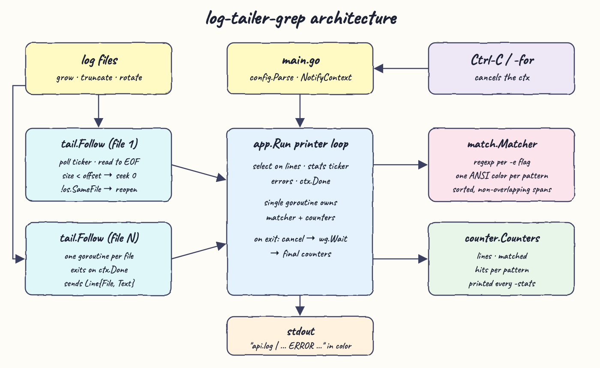
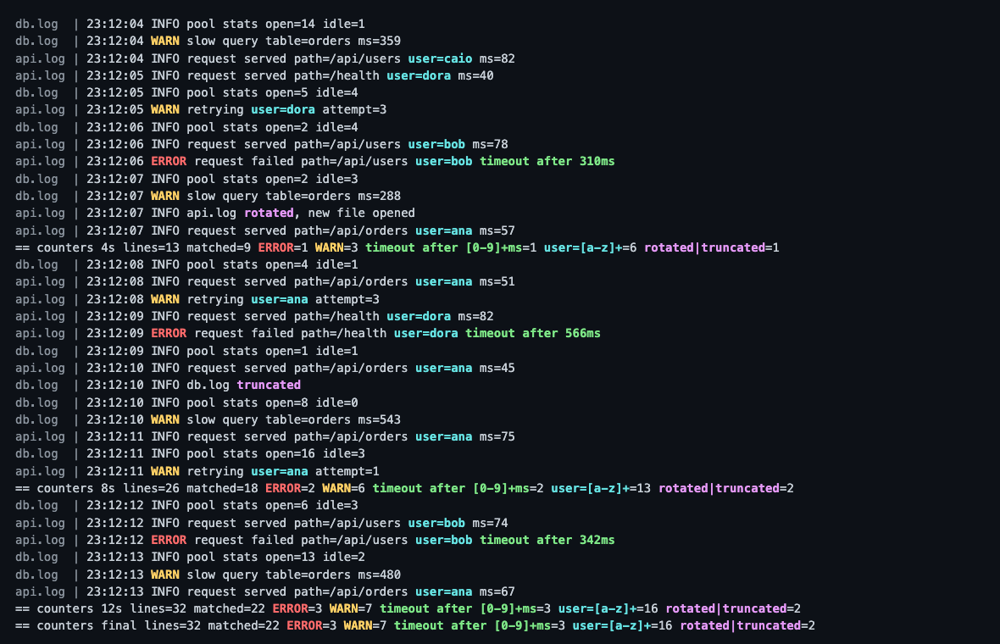

<p align="center"></p>

`log-tailer-grep` is a multi-file `tail -f` with grep built in. It follows several log files at once, prints each new line with the file name in front, colors every regex hit (one ANSI color per pattern) and keeps a counter for each pattern. Counters are printed every few seconds and once more on Ctrl-C. It keeps working when a file is truncated or rotated. Standard library only.

## How it Works?

- `main.go` parses flags into one `config.Config` and builds a context with `signal.NotifyContext` (Ctrl-C and SIGTERM cancel it). `-for` adds a timeout.
- `app.Run` starts one `tail.Follow` goroutine per file. Each one sends `tail.Line{File, Text}` on a shared channel.
- `tail.Follow` polls on a ticker (no fsnotify). Each tick reads to EOF and keeps a partial line until its `\n` arrives.
- After reading, it calls `os.Stat` on the path. If `os.SameFile` says the inode changed, the file was rotated: it reopens the path and reads the new file from the start. If the size is smaller than the read offset, the file was truncated: it seeks back to 0.
- A missing file is not an error. The follower keeps polling and picks the file up once it exists.
- A single printer goroutine selects on lines, the stats ticker, follower errors and `ctx.Done`. It runs `match.Matcher` on each line, records hits in `counter.Counters` and writes `name | colored line`.
- On exit the printer cancels the context, waits for every follower with `sync.WaitGroup`, then prints the final counters. Every goroutine exits through the context.

## Architecture



The [SVG source](assets/architecture.svg) uses the Caveat font, a wobble filter, pastel boxes and solid arrows.

## Features

- **Multi-file follow:** any number of files, each line prefixed with the padded base name (`api.log |`, `db.log  |`).
- **Regex highlighting:** each `-e` pattern gets its own bold ANSI color; every occurrence in the line is painted.
- **Per-pattern counters:** total lines, matched lines and hits per pattern, every `-stats` and on Ctrl-C.
- **Truncation:** `copytruncate` style or `> file` resets are detected by size and read from offset 0.
- **Rotation:** `mv app.log app.log.1` plus a new `app.log` is detected by inode and the new file is followed.
- **Late files:** a path that does not exist yet is followed as soon as it is created.
- **grep or full view:** by default only matching lines print; `-all` prints everything and still counts.
- **Pipe friendly:** `-no-color` drops escape codes; counters still work.

## Stack

- **Go 1.26:** `sync.WaitGroup.Go`, `signal.NotifyContext` and `testing.B.Loop` keep the code short.
- **Standard library only:** `regexp` for patterns, `os.SameFile` for rotation, `flag` for the CLI, `html` for the screenshot helper.
- **Playwright (npx, scripts only):** turns the HTML render of the ANSI output into the README printscreen.

## Contracts

CLI: `log-tailer-grep [flags] FILE...`

| Flag | Default | Meaning |
|------|---------|---------|
| `-e REGEX` | none | pattern to highlight and count, repeat for more patterns; with no `-e` every line prints |
| `-interval D` | `200ms` | poll interval per file |
| `-stats D` | `5s` | print counters every D, `0` disables periodic counters |
| `-for D` | `0` | stop after D, `0` runs until Ctrl-C |
| `-from-start` | `false` | read existing content instead of starting at the end |
| `-all` | `false` | print lines that match no pattern too |
| `-no-color` | `false` | disable ANSI colors |

Exit codes: `0` normal stop (Ctrl-C, SIGTERM or `-for`), `1` runtime error (bad regex, unreadable file), `2` bad flags.

Output lines:

```
<file> | <line with colored hits>
== counters <elapsed|final> lines=N matched=N <pattern>=N ...
```

Helper: `go run ./cmd/ansihtml -title T < out.ansi > out.html` converts captured ANSI output to a dark HTML page.

## Key data structures and design decisions

- `tail.Line{File, Text}`: the only thing that crosses goroutines. Followers never touch counters or stdout.
- `tail.follower`: open `*os.File`, the `os.FileInfo` taken at open time (for `os.SameFile`), the read `offset` and the `partial` line buffer.
- `match.Matcher`: compiled patterns with a fixed color by index, so `-e` order means stable colors. Hits from all patterns are sorted by start and overlapping spans are skipped, so escape codes never nest.
- `counter.Counters`: plain struct, no mutex, because only the printer goroutine writes it. Less locking, same safety, checked by `-race`.
- Polling instead of fsnotify: no dependency, works the same on every OS and on network filesystems. The cost is up to one `-interval` of delay.
- Known polling limit: if a file is truncated and rewritten past the old offset inside one interval, the shrink is not seen. Lines written to a file in the same interval right before a truncation are lost.

## How to run and test

```bash
./scripts/setup.sh
./scripts/live-tail.sh
./scripts/run.sh -e ERROR -e WARN logs/app.log
./scripts/test-all.sh
```

`live-tail.sh` writes to `.run/logs/api.log` and `.run/logs/db.log` once per second (rotating `api.log` on the 4th second and truncating `db.log` on the 7th) while the tailer follows both files.

## Results

Real run of `./scripts/printscreen.sh` (10 seconds of writes, excerpt, colors stripped):

```
db.log  | 23:12:07 INFO pool stats open=2 idle=3
db.log  | 23:12:07 WARN slow query table=orders ms=288
api.log | 23:12:07 INFO api.log rotated, new file opened
api.log | 23:12:07 INFO request served path=/api/orders user=ana ms=57
== counters 4s lines=13 matched=9 ERROR=1 WARN=3 timeout after [0-9]+ms=1 user=[a-z]+=6 rotated|truncated=1
...
db.log  | 23:12:11 INFO pool stats open=16 idle=3
api.log | 23:12:11 WARN retrying user=ana attempt=1
== counters 8s lines=26 matched=18 ERROR=2 WARN=6 timeout after [0-9]+ms=2 user=[a-z]+=13 rotated|truncated=2
...
== counters final lines=32 matched=22 ERROR=3 WARN=7 timeout after [0-9]+ms=3 user=[a-z]+=16 rotated|truncated=2
```

The writer produced exactly 32 lines in 10 seconds (20 INFO, 3 ERROR, 7 WARN, plus the rotated and truncated markers). The tailer saw all 32 across one rename rotation and one truncation, so no line was lost.

Ctrl-C check: start the binary, append a line, send SIGINT. Output:

```
s.log | ERROR a
s.log | ERROR b
== counters final lines=2 matched=2 ERROR=2
```

Benchmark from `test-all.sh` (Apple M4 Max, 3 patterns, 76 byte line with 3 hits):

```
BenchmarkMatch-16    	  287485	       814.1 ns/op	     877 B/op	      14 allocs/op
```

A second run on the same machine, while other builds were running, gave 1433 ns/op, so expect roughly 0.7 to 1.2 million highlighted lines per second on one core. That is far above the rate a log poller feeds it.

### Printscreen



This is the colored terminal output of `live-tail.sh`, rendered by `cmd/ansihtml` and captured with Playwright. The gray prefix is the file name. `ERROR` is red, `WARN` yellow, `timeout after Nms` green, `user=name` cyan and the `rotated`/`truncated` markers magenta. The `api.log rotated` line shows the tailer switching to the new file after `mv`, and `db.log truncated` shows it reading from offset 0 again. The `== counters` lines appear every 4 seconds and once more at exit; their names use the same colors as the hits.

## Scripts

| Script | What it does |
|--------|--------------|
| `scripts/setup.sh` | downloads modules and builds `bin/log-tailer-grep` |
| `scripts/run.sh` | builds and runs the tailer with your flags and files |
| `scripts/live-tail.sh [seconds]` | writes sample logs under `.run/logs` (with one rotation and one truncation) while tailing them, 1 to 60 seconds, default 12 |
| `scripts/printscreen.sh` | runs `live-tail.sh`, converts the ANSI output to HTML and screenshots `printscreens/live-tail.png` |
| `scripts/assets.sh` | renders `assets/logo.svg` and `assets/architecture.svg` to PNG |
| `scripts/test-all.sh` | `bash -n` on every script, gofmt, go vet, `go test -race`, match benchmark, smoke run of the binary |
| `scripts/common.sh` | shared paths, `log`/`fail`/`require`, `build` and the sample log writer |
