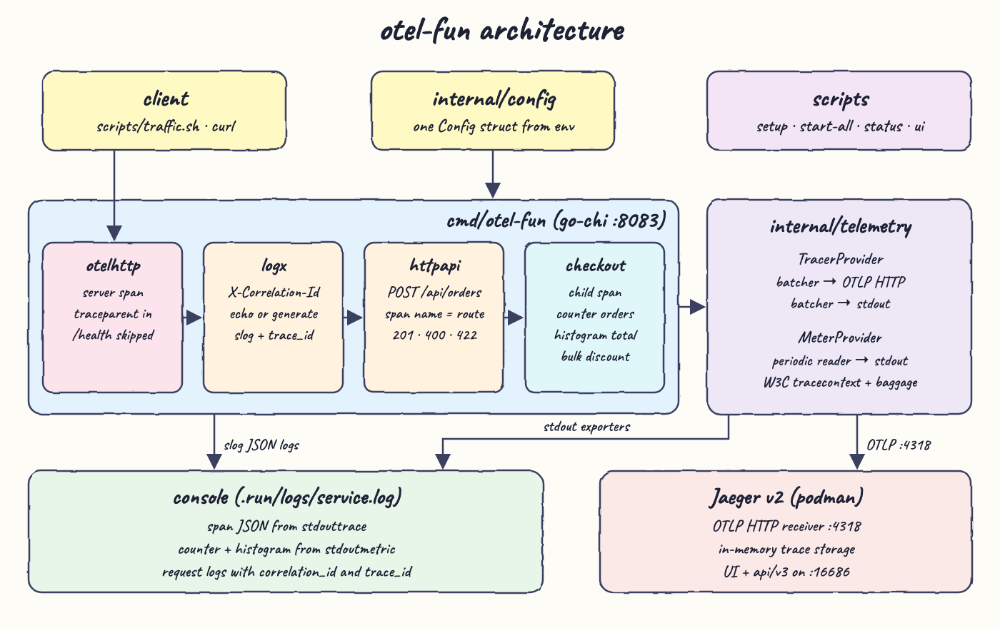
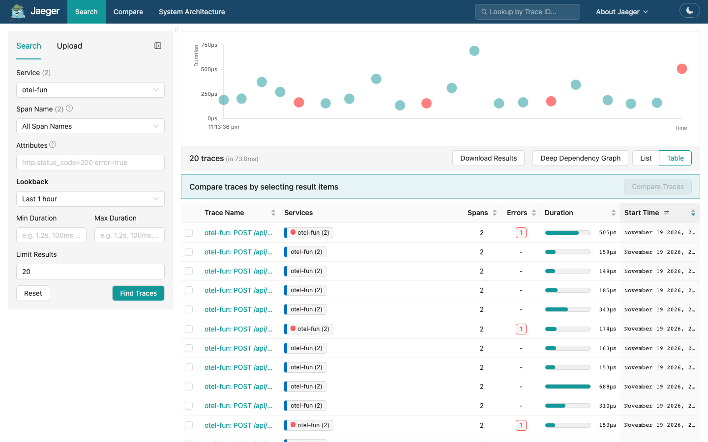
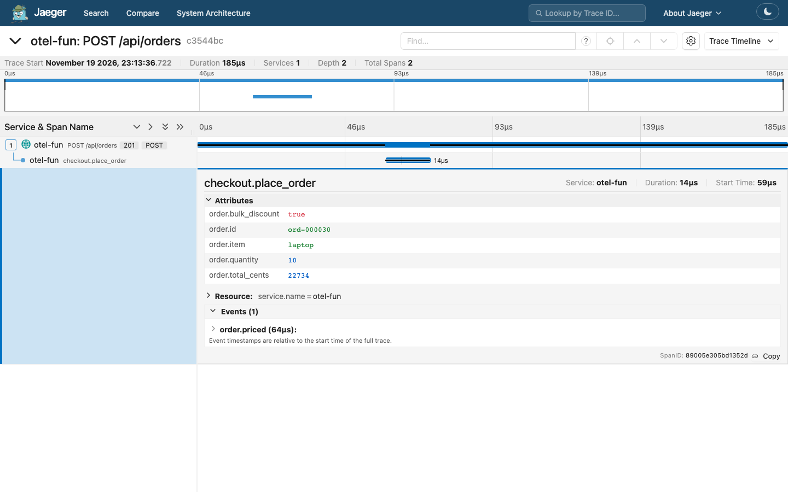
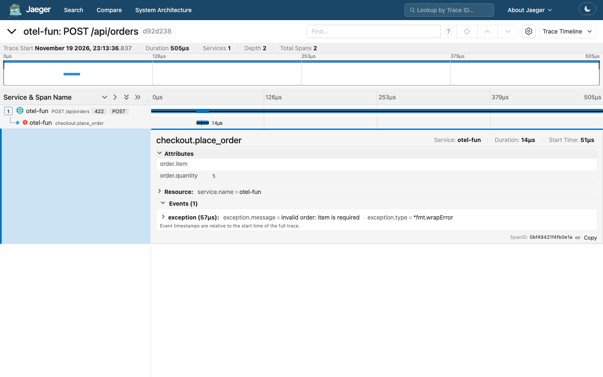
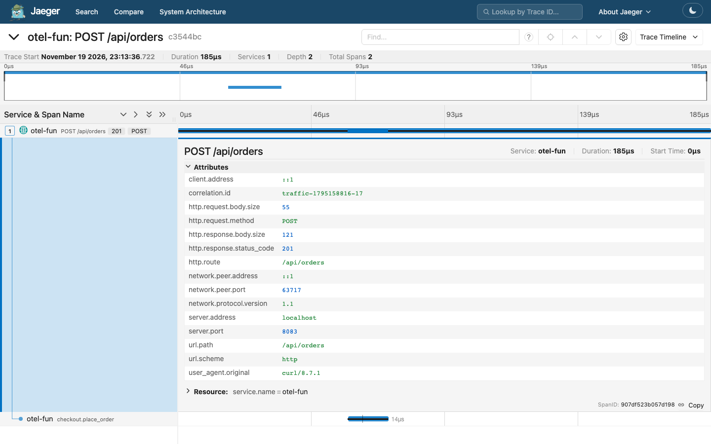

<p align="center"></p>

A small go-chi order service instrumented with OpenTelemetry. Every order request produces a server span and a
child business span, two business metrics (a counter and a histogram), and structured slog logs that carry the
`X-Correlation-Id` and the trace id. Traces go to the console and to a local Jaeger v2 over OTLP HTTP. Metrics go
to the console.

## How it Works?

1. `cmd/otel-fun` loads one `Config` struct from env, builds the telemetry providers and starts the chi router on `:8083`.
2. `otelhttp` wraps the whole router: it continues an incoming `traceparent` or starts a new trace and opens the server span. `/health` is filtered out.
3. `logx.Middleware` reads `X-Correlation-Id` (or generates one), puts it in the context and echoes it on the response.
4. After chi routes the request, the `observe` middleware renames the server span to `METHOD /route`, tags `http.route` and `correlation.id`, and writes one access log line.
5. `POST /api/orders` calls `checkout.Service.Place`, which opens the child span `checkout.place_order`, validates, prices (10% off from 10 units), adds the `order.priced` event, bumps `checkout.orders{outcome}` and records `checkout.order.total`.
6. Rejected orders mark the child span as error with the exception event and return 422 with the correlation id in the body.
7. The `TracerProvider` has two batchers (OTLP HTTP to Jaeger on `:4318` and stdout). The `MeterProvider` has a periodic reader to stdout every 15s.
8. `logx.From(ctx, logger)` adds `correlation_id`, `trace_id` and `span_id` to every log line, so a log line points to its trace in Jaeger.

## Architecture



## Features

* Server spans from `otelhttp` named after the chi route (`POST /api/orders`), not the raw path.
* Child business span `checkout.place_order` with order attributes, an `order.priced` event, and error status on rejection.
* Metrics: `checkout.orders` counter split by `outcome` (accepted, rejected) and `checkout.order.total` histogram in cents with explicit buckets.
* Also the standard `otelhttp` server metrics (request duration, body sizes) on the same `MeterProvider`.
* Dual trace export: stdout (`stdouttrace`) and Jaeger v2 (`otlptracehttp`).
* W3C `traceparent` propagation, so upstream callers join the same trace.
* Centralized `logx` package: JSON slog, `X-Correlation-Id` middleware, logger enriched with correlation and trace ids.
* Health probe `/health` is not traced, so probes do not flood Jaeger.
* Graceful shutdown on SIGINT and SIGTERM flushes pending spans and metrics.

## Stack

| Piece | Version |
|---|---|
| Go | 1.26 |
| github.com/go-chi/chi/v5 | v5.5.0 |
| go.opentelemetry.io/otel, sdk, sdk/metric, trace, metric | v1.47.0 |
| otlptracehttp, stdouttrace, stdoutmetric exporters | v1.47.0 |
| go.opentelemetry.io/contrib/instrumentation/net/http/otelhttp | v0.72.0 |
| Jaeger | v2 (`jaegertracing/jaeger:latest`, 2.23.0 when written) |
| podman + podman-compose | Jaeger container |

## Contracts

### POST /api/orders

Request headers: `Content-Type: application/json`, optional `X-Correlation-Id`, optional `traceparent`.

```json
{"item":"book","quantity":10,"unit_price_cents":1500}
```

`201 Created`

```json
{"order_id":"ord-000001","item":"book","quantity":10,"subtotal_cents":15000,"discount_cents":1500,"total_cents":13500}
```

`422 Unprocessable Entity` when a business rule fails (empty item, quantity outside 1..1000, unit price outside 1..10000000):

```json
{"error":"invalid order: item is required","correlation_id":"abc-123"}
```

`400 Bad Request` for malformed JSON or unknown fields, same error body.

Every response carries `X-Correlation-Id`.

### GET /health

`200 OK` with `{"status":"UP"}`. Not traced.

### Config (env)

| Env | Default |
|---|---|
| `PORT` | `8083` |
| `OTLP_ENDPOINT` | `localhost:4318` |
| `SERVICE_NAME` | `otel-fun` |
| `CONSOLE_EXPORT` | `true` |
| `METRIC_INTERVAL` | `15s` |

## Key design decisions

* No global providers. `telemetry.Setup` returns a `Providers` value that is passed to `otelhttp` and to `checkout.New`, so tests plug in a `tracetest.SpanRecorder` and a `ManualReader` with no global state.
* `httpapi` depends on a one method `Placer` interface defined where it is consumed, not on the concrete service.
* Money is `int64` cents. No floats, so the discount math is exact.
* Validation errors wrap `checkout.ErrInvalidOrder`; the handler maps them with `errors.Is` to 422, everything else to 500.
* The span name is set after routing because only then chi knows the route pattern; this keeps span names low cardinality.
* Metrics go only to stdout because Jaeger stores traces, not metrics.
* Jaeger publishes only the OTLP HTTP port. The OTLP gRPC port is not needed by this service.
* `scripts/traffic.sh` proves the Jaeger path end to end: it tags every request with a run specific correlation id and polls the Jaeger `api/v3/traces` endpoint until every one of them is stored.

## How to run

```bash
./scripts/setup.sh
./scripts/start-all.sh
./scripts/traffic.sh 20
./scripts/ui.sh
./scripts/stop-all.sh
```

Single request:

```bash
curl -s -X POST http://localhost:8083/api/orders \
  -H 'Content-Type: application/json' -H 'X-Correlation-Id: my-id-1' \
  -d '{"item":"book","quantity":10,"unit_price_cents":1500}'
```

Console telemetry lands in `.run/logs/service.log` (span JSON, metric JSON every 15s, slog JSON).

## How to test

```bash
./scripts/test-all.sh
```

It runs `gofmt -l`, `go vet ./...` and `go test -race -count=1 ./...`. The tests prove that the business span is a
child of the server span, that an incoming `traceparent` is continued, that `/health` creates no spans, that the
counter and histogram move by outcome, that the bulk discount threshold is inclusive, and that the correlation id is
kept, generated or replaced.

## Printscreens

### Jaeger search



Search for service `otel-fun` after `scripts/traffic.sh`. Each request is one trace with 2 spans. The red dots and
the `1` in the Errors column are the rejected orders, where the business span carries error status.

### Trace with the business span



The server span `POST /api/orders` (201) with its child `checkout.place_order`. The child shows the order attributes,
`order.bulk_discount=true` for 10 units, and the `order.priced` event.

### Rejected order trace



A 422 request. The child span is marked as error and carries the `exception` event with
`invalid order: item is required`.

### Server span attributes



The `otelhttp` server span with the semantic convention attributes, the `http.route` tag and the `correlation.id`
that `scripts/traffic.sh` sent in `X-Correlation-Id`, which is the same id found in the slog lines.

## Scripts

All scripts live in `scripts/` and run from any directory of the repository.

| Script | What it does |
|---|---|
| `./scripts/setup.sh` | Pulls the Jaeger image, downloads Go modules and builds `bin/otel-fun` |
| `./scripts/start-all.sh` | Starts Jaeger with podman-compose, starts the service and prints the full link of each one |
| `./scripts/status.sh` | Shows every service port as UP or DOWN |
| `./scripts/traffic.sh` | Sends orders (valid and invalid) and waits until Jaeger stored every trace |
| `./scripts/test-all.sh` | Runs gofmt, go vet and the race enabled test suite |
| `./scripts/ui.sh` | Opens the Jaeger UI on the otel-fun service |
| `./scripts/stop-all.sh` | Stops every service |

Ports are declared in `scripts/ports.env`: service `8083`, jaeger `16686`, otlp `4318`.

```bash
./scripts/setup.sh
./scripts/start-all.sh
./scripts/status.sh
./scripts/ui.sh
./scripts/stop-all.sh
```
