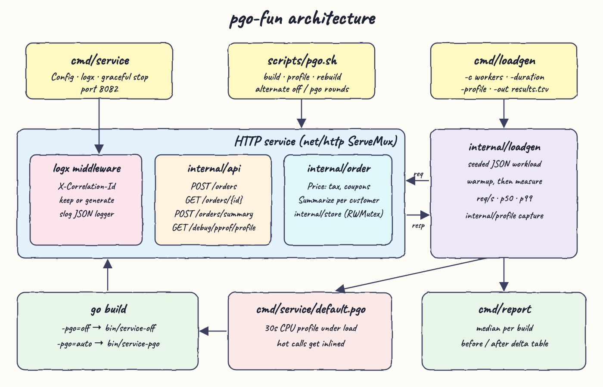

<p align="center"></p>

# pgo-fun

A small JSON-heavy order pricing HTTP service used to measure Go profile-guided optimization (PGO). A Go load generator hammers the service, pulls a CPU profile from `net/http/pprof`, saves it as `cmd/service/default.pgo`, and the scripts rebuild the service with `-pgo=off` and `-pgo=auto` and compare throughput and latency in a before/after table.

## How it Works?

1. `scripts/pgo.sh` builds `bin/service-off` with `-pgo=off` and starts it on port 8082 (from `scripts/ports.env`).
2. `cmd/loadgen` seeds 256 orders, warms up for 3s and then drives 32 concurrent workers over a fixed mix: create order, read order, summarize a batch of 100 orders.
3. While measuring, loadgen calls `GET /debug/pprof/profile?seconds=30` on the service and writes the CPU profile.
4. The profile is copied to `cmd/service/default.pgo`, the file `go build -pgo=auto` picks up for the main package.
5. `bin/service-pgo` is built with `-pgo=auto`. The compiler uses the hot call graph to inline hot calls more aggressively and devirtualize hot interface calls.
6. The script runs N alternating rounds (`off`, `pgo`, `off`, `pgo`, ...), each on a fresh process, so machine drift hits both builds equally.
7. Every round appends one line to `.run/results.tsv`, and `cmd/report` prints each round plus the median of each build with the delta.

## Architecture



The [SVG source](assets/architecture.svg) uses the Caveat font, a wobble filter, pastel boxes and solid arrows.

## Features

- **Order pricing API**: create, read and batch summarize orders with tax per country and coupons, all JSON in and out.
- **Method routing**: Go 1.22+ `ServeMux` patterns like `POST /orders` and `GET /orders/{id}`, wrong verbs get 405.
- **Correlation ids**: every response carries `X-Correlation-Id`, kept from the caller when safe or generated.
- **Central logging**: one `log/slog` JSON logger in `internal/logx`; per request logs only at `LOG_LEVEL=debug` so they do not skew the benchmark.
- **Built-in profiling**: `/debug/pprof/` and `/debug/pprof/profile` exposed for profile capture.
- **Load generator**: seeded, repeatable workload with warmup, req/s, p50, p99 and an error counter so a broken build cannot look fast.
- **Automated compare**: one script builds, profiles, rebuilds, alternates rounds and prints the table.
- **Ops scripts**: start, stop and status with pid files in `.run/` and logs in `.run/logs/`.

## Stack

- **Go 1.26**: PGO is stable since 1.21 and `-pgo=auto` is the default build mode.
- **net/http**: the stdlib server and `ServeMux` method patterns are enough, and they are what the profile optimizes.
- **encoding/json**: the classic reflection based codec, a realistic hot path for PGO.
- **net/http/pprof**: produces the pprof CPU profile format that `go build -pgo` reads.
- **log/slog**: structured logging from the stdlib.
- **bash + lsof**: scripts track the service by port and pid file.

No third party libraries, `go.mod` has no requirements.

## Contracts

Base URL `http://localhost:8082`. All bodies are JSON. Every response has an `X-Correlation-Id` header.

| Method | Path | Body | Success | Errors |
|---|---|---|---|---|
| GET | `/health` | none | 200 `{"status":"ok"}` | |
| POST | `/orders` | `Order` | 201 `Priced` | 400 malformed or unknown field, 422 business rule |
| GET | `/orders/{id}` | none | 200 `Priced` | 404 `{"error":"order not found"}` |
| POST | `/orders/summary` | `[]Order` | 200 `[]CustomerSummary` sorted by total desc | 400, 422 |
| GET | `/debug/pprof/` | none | 200 pprof index | |
| GET | `/debug/pprof/profile?seconds=N` | none | 200 CPU profile | |

```json
{"id":"o-1","customer":"ana","country":"US","coupon":"SAVE10",
 "items":[{"sku":"pen","name":"Blue pen","qty":2,"unit_cents":1000,"tags":["gift"]}]}
```

Response of `POST /orders` for the order above without the coupon:

```json
{"id":"o-1","customer":"ana","country":"US","lines":[{"sku":"pen","qty":2,"total_cents":2000}],
 "item_count":2,"subtotal_cents":2000,"discount_cents":0,"tax_cents":140,"total_cents":2140}
```

Pricing rules: tax in basis points per country (US 7%, BR 17%, DE 19%, anything else 10%), rounded half up. `SAVE10` is 10% off, `BULK` is 5% off from 10 items, any other coupon is a 422. Discount is applied before tax.

Service environment: `SERVICE_PORT` (default 8082), `SERVICE_HOST` (default 127.0.0.1), `LOG_LEVEL` (debug, info, warn, error).

Loadgen flags: `-url`, `-c` workers, `-warmup`, `-duration`, `-label`, `-out` results file, `-profile` output path, `-profile-seconds`. Report flags: `-in`, `-base`, `-cand`.

`scripts/pgo.sh` knobs: `ROUNDS` (3), `DURATION` (15s), `CONCURRENCY` (32), `PROFILE_SECONDS` (30).

## Key data structures and design decisions

- `order.Order` / `order.Priced` / `order.CustomerSummary`: money is `int64` cents, never floats, so totals are exact.
- `order.Price` and `order.Summarize` are pure functions; the HTTP layer only decodes, calls them and encodes.
- `api.Store` is a two method interface defined by its consumer; `store.Memory` is a map behind a `sync.RWMutex`.
- `config.Config` is the only config, loaded once in `cmd/service/main.go` from an injected `getenv`, so it is testable.
- `logx.Middleware` validates incoming correlation ids (charset and length) to keep logs free of injected content.
- `loadgen.Workload` is generated from a fixed seed, pre-marshaled once, so the load generator spends its CPU on HTTP and not on building payloads.
- The profile is taken from the `-pgo=off` build, the same binary layout production would profile before turning PGO on.
- Rounds alternate builds and the report uses the median, because a single run on a laptop is noisy.
- `default.pgo` is committed; other `*.pprof` files are ignored.

## How to run and test

```bash
./scripts/setup.sh
./scripts/test-all.sh
./scripts/start-all.sh
./scripts/status.sh
./scripts/stop-all.sh
./scripts/pgo.sh
ROUNDS=5 DURATION=20s ./scripts/pgo.sh
```

## Results

Measured on an Apple M4 Max (16 cores), go1.26.4, 32 workers, 15s per round, loadgen and service on the same machine. **Read the caveat first:** while these runs happened, other heavy builds were running on the same machine (load average between 45 and 110 on 16 cores). The `off` build alone swung between 4477 and 7216 req/s across rounds, which is far larger than any PGO effect. Treat the numbers below as real but noisy.

Run 1, `./scripts/pgo.sh` (3 rounds):

```
round  build            req/s        p50        p99   errors
1      off             5970.0    1.491ms   34.481ms        0
1      pgo             7036.4    1.265ms   27.403ms        0
2      off             6236.1    1.391ms   32.955ms        0
2      pgo             6578.4    1.431ms   30.553ms        0
3      off             6845.1    1.312ms   27.935ms        0
3      pgo             7012.5    1.315ms   27.198ms        0

median                    off            pgo     delta
req/s                  6236.1         7012.5    +12.5%
p50 latency           1.391ms        1.315ms     -5.5%
p99 latency          32.955ms       27.403ms    -16.8%
errors                      0              0
```

Run 2, `ROUNDS=5 ./scripts/pgo.sh` (fresh profile, 5 rounds):

```
round  build            req/s        p50        p99   errors
1      off             6856.8    1.251ms   30.030ms        0
1      pgo             7622.8    1.159ms   24.890ms        0
2      off             4477.4    1.538ms   69.490ms        0
2      pgo             7329.3    1.145ms   27.502ms        0
3      off             6759.9    1.180ms   31.251ms        0
3      pgo             8282.7    1.048ms   21.822ms        0
4      off             7216.2    1.192ms   27.341ms        0
4      pgo             4301.0    1.720ms   61.942ms        0
5      off             5380.9    1.495ms   47.051ms        0
5      pgo             3998.7    1.726ms   63.603ms        0

median                    off            pgo     delta
req/s                  6759.9         7329.3     +8.4%
p50 latency           1.251ms        1.159ms     -7.4%
p99 latency          31.251ms       27.502ms    -12.0%
errors                      0              0
```

What the compiler actually did with the profile (deterministic, not affected by noise):

- `go build -gcflags='all=-d=pgodebug=1'` reports 183 distinct hot call edges that got inlined above the normal inlining budget, mostly in `encoding/json` (`(*Decoder).readValue`, `(*decodeState).unmarshal`, `scanWhile`, `rescanLiteral`, `cachedTypeFields`, `appendString`), `strconv` and `bufio`.
- `go version -m bin/service-pgo` shows the `-pgo=.../cmd/service/default.pgo` build setting; `bin/service-off` has none.
- Binary size grows from 9,434,914 to 9,616,546 bytes (+1.9%), the cost of the extra inlining.
- The profile itself shows where time goes: about 35% in network syscalls, about 13% in `runtime.usleep` and about 10% in `madvise`, while `encoding/json` decoding is around 15% cumulative. PGO can only speed up the Go code part, so the ceiling for this service is limited.

Honest conclusion: both runs show the PGO build ahead on the median (+8.4% and +12.5% req/s, lower p50 and p99) with zero errors, but the round to round spread on this busy machine is bigger than that gap, and in run 2 PGO lost two of five rounds. The Go team reports typical gains of 2% to 14%; this result is consistent with a gain in that range, not proof of a specific number. For a clean number, run `ROUNDS=7 ./scripts/pgo.sh` on an idle machine.

Brief handler benchmarks from `test-all.sh` (single run; `go test` on `internal/api` does not pick up `cmd/service/default.pgo`, so these are non PGO numbers). I also tried `go test -pgo=off` against `-pgo=cmd/service/default.pgo` on these benchmarks in alternating rounds, but under that machine load the results flipped direction from round to round, so they are not reported as a gain:

```
BenchmarkCreateOrder-16    	   34210	      7149 ns/op	    8229 B/op	      46 allocs/op
BenchmarkSummary100-16     	     700	    356662 ns/op	  105177 B/op	     739 allocs/op
```

## Scripts

All scripts live in `scripts/` and run from any directory. The only port is `service=8082` in `scripts/ports.env`.

| Script | What it does |
|---|---|
| `./scripts/setup.sh` | Downloads modules, builds `bin/service` (`-pgo=auto`), `bin/loadgen` and `bin/report` |
| `./scripts/run.sh` | Runs the service in the foreground with debug request logs, Ctrl-C to stop |
| `./scripts/start-all.sh` | Starts the service in the background, pid in `.run/service.pid`, log in `.run/logs/service.log`, prints `http://localhost:8082`; safe to run twice |
| `./scripts/status.sh` | Shows UP or DOWN and the pid per port, exits with the number of services down |
| `./scripts/stop-all.sh` | Stops the service and fails if the port is still open; safe to run twice |
| `./scripts/pgo.sh` | Full loop: build `-pgo=off`, profile under load, save `cmd/service/default.pgo`, build `-pgo=auto`, alternate rounds, print the table |
| `./scripts/test-all.sh` | Bash syntax, gofmt, go vet, `go test -race`, builds with both pgo modes, brief handler benchmarks |
