<p align="center"></p>

# Go Playground

A local admin UI to write and run Go code, with line numbers, syntax highlighting and auto-complete. It also has rich markdown docs and runnable samples for the core Go concurrency features: goroutines (Go's coroutines), channels, buffered channels, select, sync, atomics, context, worker pools and pipelines. It runs as a web app, on a phone-sized screen, and as a macOS Electron app.

## How it Works

1. One Go binary serves the JSON API and the UI, with the UI, docs and samples embedded through `embed`.
2. When you press Run, the code goes to `POST /api/run`. The server writes it to a fresh temp dir, runs `go build`, then runs the binary with a 10s timeout and a 64KB output cap.
3. Auto-complete calls `GET /api/complete`. At startup, the server parses the real standard library sources in `GOROOT` with `go/parser`, so suggestions always match your installed Go.
4. The editor is a transparent textarea over a highlighted `<pre>`, with a line number gutter. Native copy, paste, cut and undo keep working.
5. Docs are markdown rendered to HTML by a small Go renderer. Every `package main` code block gets a "Run in Playground" button.
6. The Electron app runs `scripts/start-all.sh` on launch, shows a boot screen with every service, and runs `scripts/stop-all.sh` on quit.

## Architecture

<p align="center">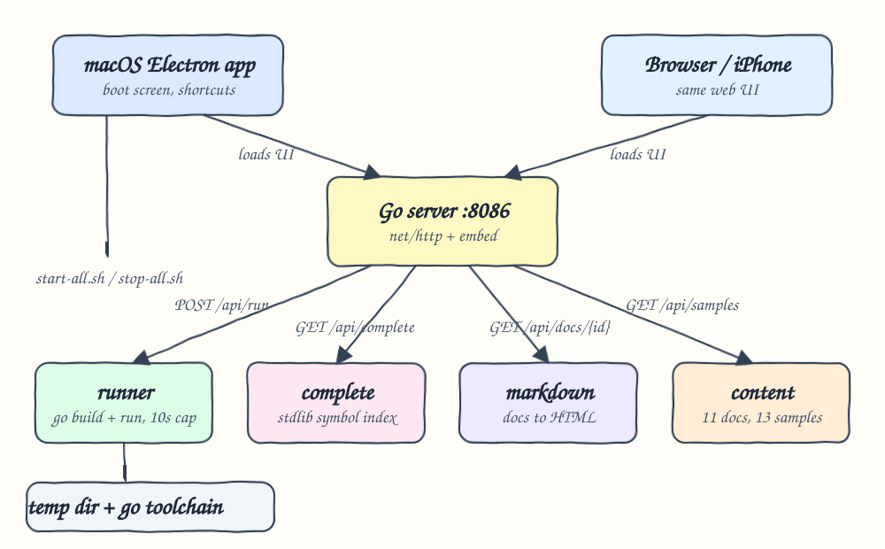</p>

## Features

- **Run Go code**: real `go build` plus run, with stdout, stderr, the program's exit code and duration.
- **Syntax highlighting**: keywords, types, builtins, packages, strings, numbers, comments, and the channel operator `<-` in its own color.
- **Line numbers**: the current line is bold, and compile error lines turn red.
- **Auto-complete**: keywords, builtins, snippets, and the exported symbols of 24 stdlib packages, with function signatures.
- **Format**: runs gofmt through `go/format`, so code style is never a question.
- **Editor helpers**: auto-indent, bracket pairs, and Tab inserts a tab.
- **11 docs**: goroutines, channels, buffered channels, select, sync, atomics, context, worker pools, pipelines, defer/panic/recover and generics, with tables and callouts.
- **13 samples**: complete programs you can open or run in one click.
- **Search (⌘ K)**: jump to any tab, doc, sample or action.
- **Shortcuts (⌘ /)**: grouped and colored, with a filter box.
- **Panels**: every panel can expand to almost full screen or hide to a side tab, and its hidden state is remembered.
- **macOS app**: single instance, saved window position, full screen, double-click to maximize, zoom, and screenshot to the Desktop.
- **Responsive**: works on a phone with 44px touch targets and no horizontal scroll.

## Stack

- **Go 1.26 standard library**: `net/http`, `go/parser`, `go/format`, `embed`, `log/slog`. No third-party Go modules.
- **Vanilla HTML, CSS and JS**: no framework and no editor library, so nothing to keep up to date.
- **Electron**: wraps the same UI as a macOS app.
- **@electron/packager**: builds the `.app` bundle.
- **Bash scripts**: one set of commands for setup, start, stop, status, tests and install.

## API

| Method | Path | Body | Response |
|---|---|---|---|
| GET | `/api/health` | - | `{"status":"ok","services":[{"name","status"}]}` |
| POST | `/api/run` | `{"code"}` | `{"stdout","stderr","exitCode","durationMs","timedOut"}` |
| POST | `/api/format` | `{"code"}` | `{"code"}`, or 400 with `{"error"}` |
| GET | `/api/complete?prefix=fmt.Pr` | - | `[{"label","kind","detail","insert"}]` |
| GET | `/api/docs` | - | `[{"id","title","summary"}]` |
| GET | `/api/docs/{id}` | - | `{"id","title","html"}` |
| GET | `/api/samples` | - | `[{"id","title","code"}]` |

Errors map to status codes in one place: 400 for bad input or empty code, 404 for an unknown doc, and 500 otherwise.

## Design Decisions

- **Build, then run**: `go run` always exits with 1 on failure. Building first and running the binary gives you the program's real exit code, for example 2 for a panic and 3 for `os.Exit(3)`.
- **Bounded runs**: a context timeout kills infinite loops, and a capped writer stops output floods from using all the memory.
- **No sandbox, bound to 127.0.0.1**: code runs with your own permissions, so the server only listens locally.
- **Completion index from real sources**: a prefix lookup over keywords, builtins and the exported identifiers of each package, keyed by package name.
- **Samples are tested**: a test runs every sample and every runnable doc block, so a broken sample fails the build.
- **One shortcut map**: the tooltips, the ⌘ / modal and the key handler all read the same list, so they never disagree.

## How to Run

```bash
./scripts/setup.sh
./scripts/start-all.sh
./scripts/ui.sh
./scripts/test-all.sh
./scripts/stop-all.sh
```

macOS app:

```bash
./scripts/install.sh
./scripts/uninstall.sh
```

`install.sh` first uninstalls any installed copy, then packages and installs exactly one `Go Playground.app` into `/Applications`.

## Printscreens

### Playground
The editor with line numbers and highlighting. The channel operator `<-` stands out, and the output panel shows the exit code and run time.

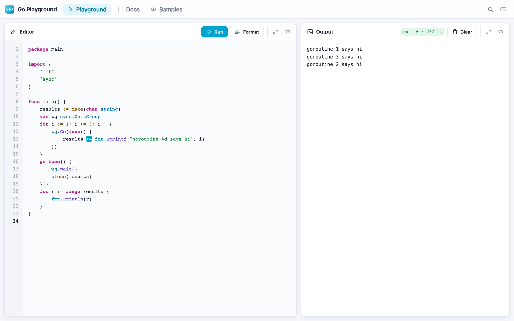

### Auto-complete
Typing `sync.Wa` suggests `WaitGroup`, parsed from the real `sync` package. Tab or Enter accepts it.

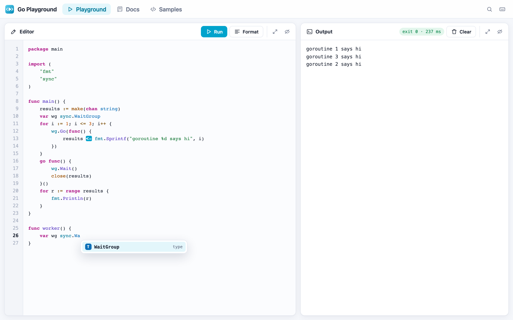

### Docs
The Channels article, with a callout, tables, and highlighted code that has Copy and "Run in Playground" buttons.

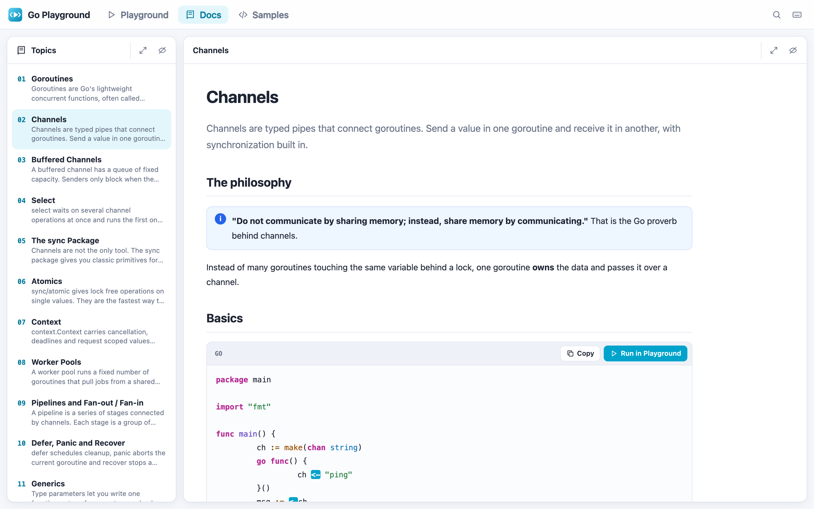

### Docs deep dive
The Select article: timeouts, non-blocking operations and multiplexing.

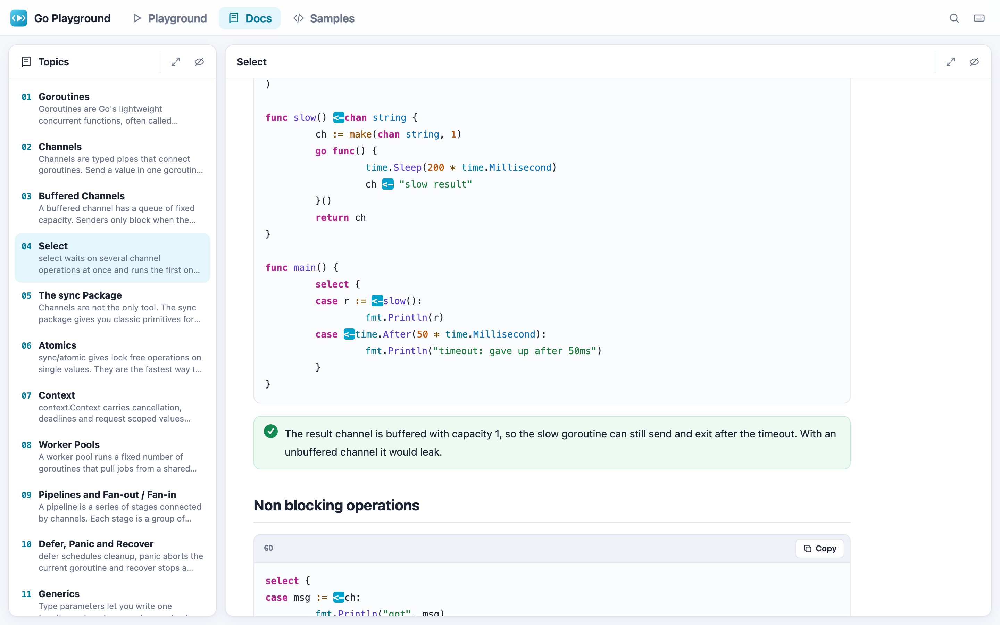

### Samples
The sample list with a read-only, highlighted preview. Open loads the sample into the editor, and Run also runs it.

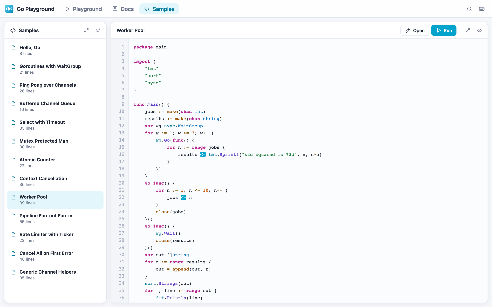

### Search (⌘ K)
One search over tabs, docs, samples and actions, with an icon on every entry.

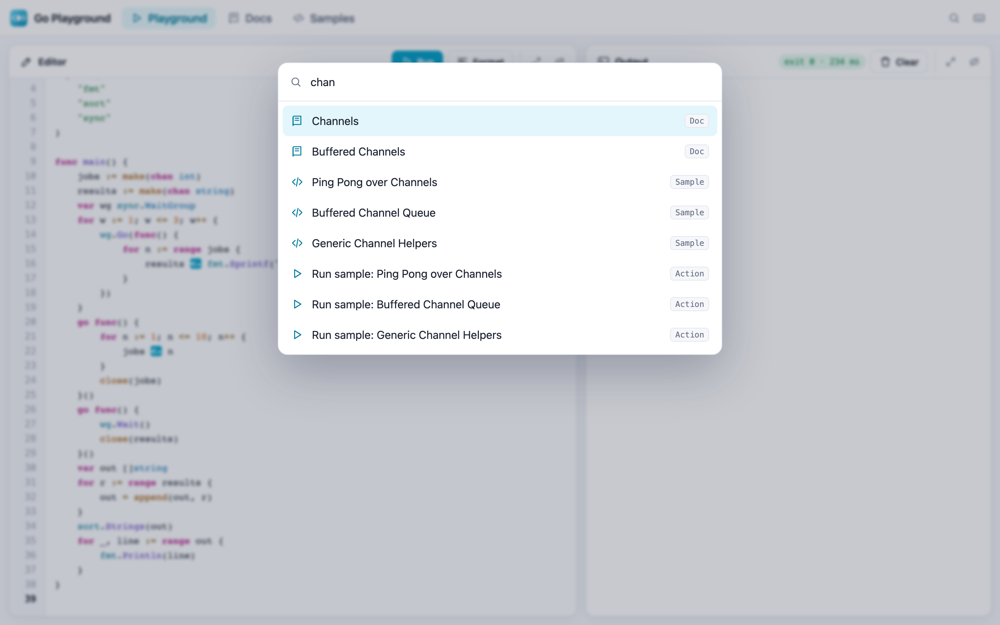

### Shortcuts (⌘ /)
Shortcuts grouped by area, each group in its own color, with a filter box and a match count.

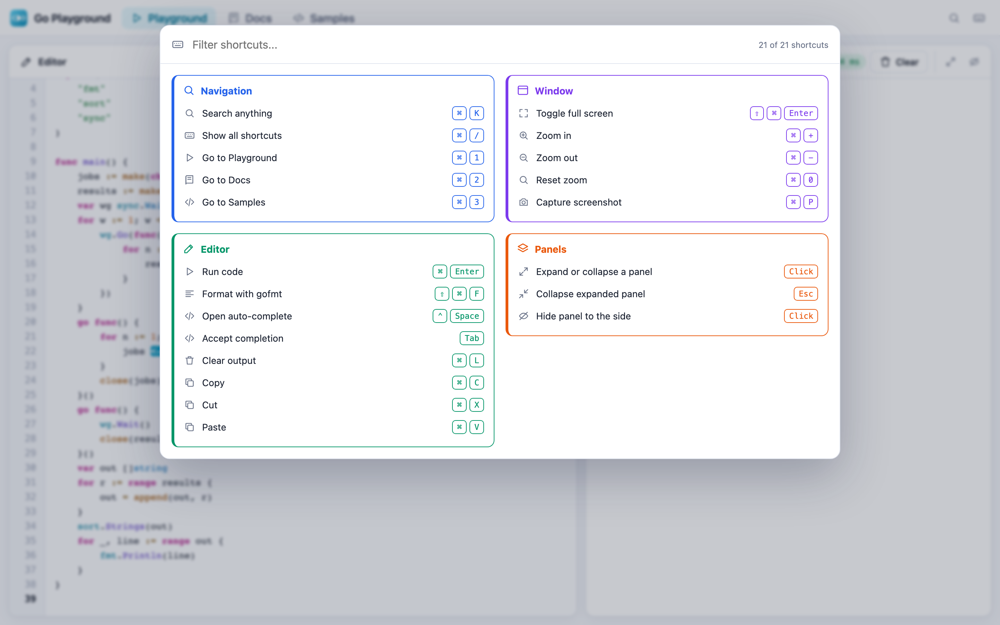

### Hidden panel
The Output panel hidden to a thin tab on the right edge. The editor takes the freed space, and a click on the tab restores the panel.

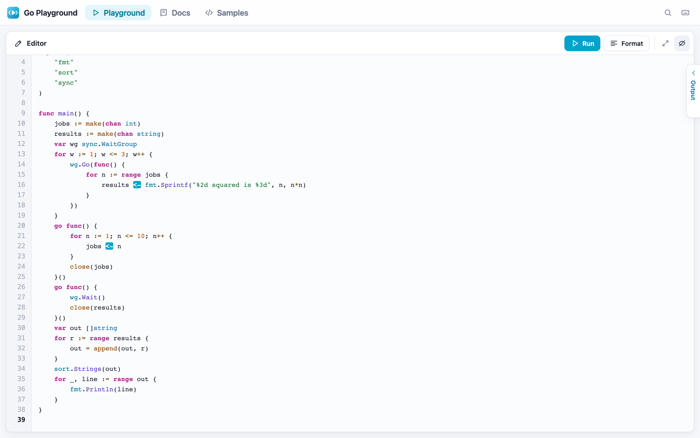

### Expanded panel
The editor expanded to almost full screen. Esc collapses it.

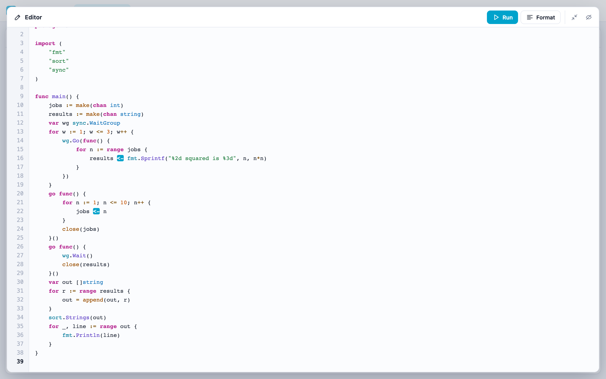

### Compile errors
A compile error turns its line red in the gutter, and the output shows the compiler message.

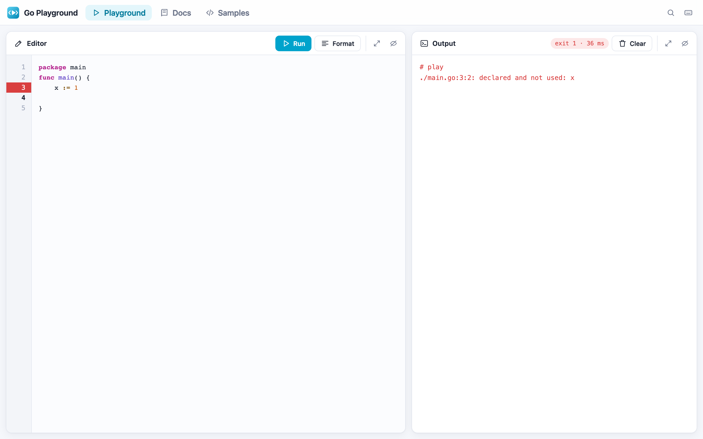

### Mobile
The same UI on a phone-sized screen: panels stack, and tabs become 44px touch targets.

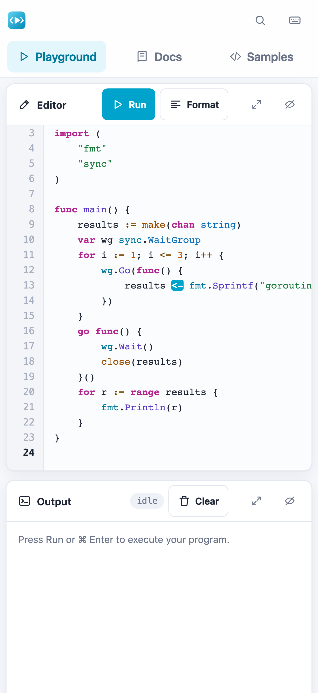
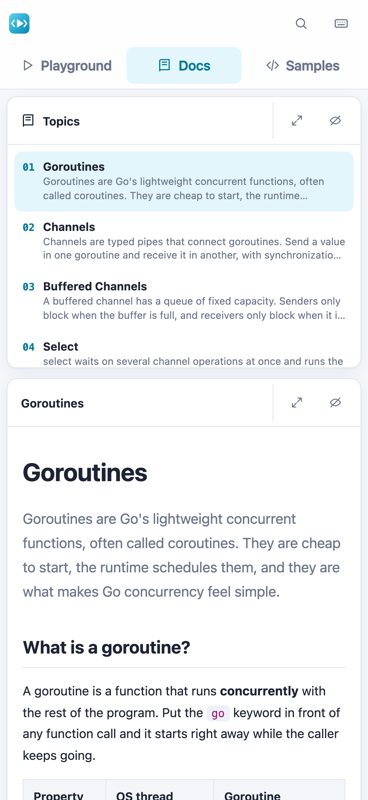

## Scripts

All scripts live in `scripts/` and run from any directory of the repository.

| Script | What it does |
|---|---|
| `./scripts/setup.sh` | Builds the server and installs the Electron dependencies |
| `./scripts/start-all.sh` | Starts the server and prints the full link |
| `./scripts/status.sh` | Shows the server port as UP or DOWN |
| `./scripts/test-all.sh` | Runs gofmt, go vet, the Go tests, the web tests and the Electron tests |
| `./scripts/ui.sh` | Opens the UI in the browser |
| `./scripts/stop-all.sh` | Stops the server |
| `./scripts/install.sh` | Installs exactly one copy of the macOS app |
| `./scripts/uninstall.sh` | Quits and removes the macOS app |

Ports are declared in `scripts/ports.env` (API on 8086).

```bash
./scripts/setup.sh
./scripts/start-all.sh
./scripts/status.sh
./scripts/ui.sh
./scripts/stop-all.sh
```
