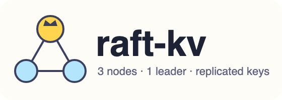
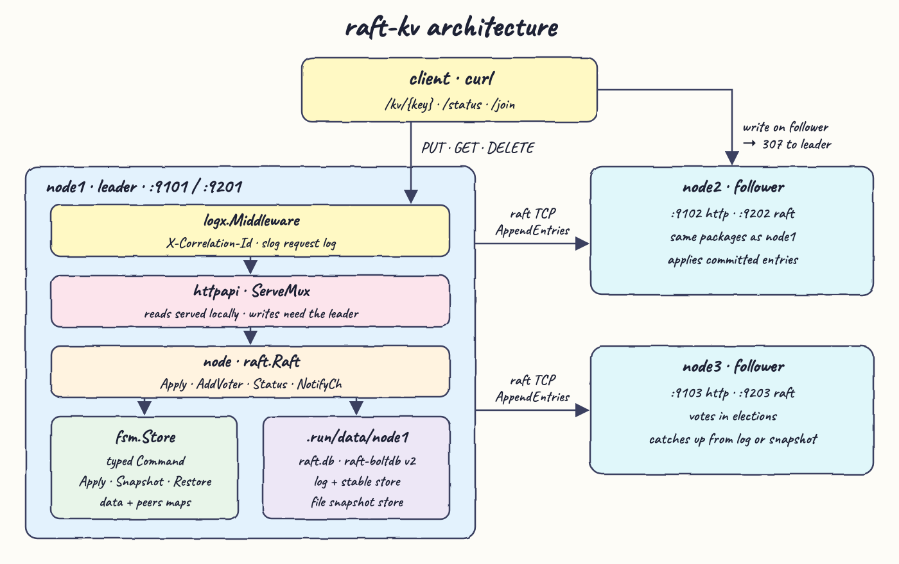

<p align="center"></p>

# raft-kv

A three-node replicated key-value store built on [hashicorp/raft](https://github.com/hashicorp/raft). Every node runs an HTTP API. Writes go through the Raft leader and are replicated to a quorum before they are acknowledged. Reads are served from the local copy on any node. Kill the leader and the two survivors elect a new one in a few seconds, keep every committed key and keep accepting writes.

## How it Works

1. `node1` starts with `-bootstrap` and becomes a single-node cluster leader.
2. `node2` and `node3` start with `-join localhost:9101` and call `POST /join`; the leader runs `AddVoter` and stores the new node HTTP address in the replicated FSM.
3. A `PUT /kv/{key}` on the leader is encoded as a typed `fsm.Command`, appended to the Raft log, replicated over TCP, committed by a 2 of 3 quorum and applied to every node's `fsm.Store`.
4. A write sent to a follower gets `307 Temporary Redirect` with `Location` pointing to the leader HTTP address.
5. Whenever a node wins an election it writes its own HTTP address into the FSM, so followers always know where to redirect.
6. Raft logs and stable state live in `raft.db` (raft-boltdb v2); snapshots live in a file snapshot store, both under `.run/data/<node>`.
7. A restarted node replays its local log, receives missing entries (or a snapshot) from the leader and catches up.

## Architecture



## Features

* 3 node Raft cluster with bootstrap and HTTP join
* Linearizable writes through the leader, local reads on every node
* `307` redirect from followers to the leader for `PUT`, `DELETE` and `POST /join`
* `GET /status` with role, leader, term, last index, applied index and key count
* Persistent log and stable store in BoltDB, file snapshots, restart catch-up
* Centralized `slog` logging with `X-Correlation-Id` propagation
* Graceful shutdown on `SIGINT` / `SIGTERM`
* Failover and restart scripts that prove the cluster survives losing the leader

## Stack

* Go 1.26
* github.com/hashicorp/raft v1.8.0
* github.com/hashicorp/raft-boltdb/v2 v2.4.2 (go.etcd.io/bbolt v1.4.1)
* Standard library `net/http` ServeMux with method patterns, `log/slog`, `flag`

## Contracts

| Method | Path | Body | Success | Notes | curl |
|--------|------|------|---------|-------|------|
| GET | `/kv/{key}` | - | `200 {"key","value"}` | `404` when absent, served locally | `curl -s localhost:9102/kv/a` |
| PUT | `/kv/{key}` | raw value | `200 {"key","value"}` | follower answers `307` to leader | `curl -s -L -X PUT --data-binary hello localhost:9102/kv/a` |
| DELETE | `/kv/{key}` | - | `204` | follower answers `307` to leader | `curl -s -L -X DELETE localhost:9102/kv/a` |
| GET | `/status` | - | `200` status JSON | role is `Leader`, `Follower` or `Candidate` | `curl -s localhost:9101/status` |
| POST | `/join` | `{"id","raft_addr","http_addr"}` | `200` | leader only, idempotent | `curl -s -L -X POST -d '{"id":"node4","raft_addr":"localhost:9204","http_addr":"localhost:9104"}' localhost:9101/join` |

`503 {"error":"no leader known"}` is returned for writes while an election is in progress. Every response carries `X-Correlation-Id` (taken from the request or generated).

Status response:

```json
{"id":"node2","role":"Follower","leader_id":"node3","leader_raft_addr":"127.0.0.1:9203","leader_http_addr":"localhost:9103","term":3,"last_index":11,"applied_index":11,"keys":2}
```

## Key data structures and design decisions

* `fsm.Command{Op, Key, Value}` with `Op` one of `set`, `delete`, `peer`. JSON encoded into the Raft log. Unknown ops return `fsm.ErrUnknownOp` instead of being ignored.
* `fsm.Store` holds two maps behind a `sync.RWMutex`: `data` (user keys) and `peers` (node id to HTTP address). `Snapshot` clones both, `Restore` replaces both, so a node restored from a snapshot can still redirect clients.
* `node.Node` wraps `*raft.Raft`. It is built from `node.Options` (log, stable, snapshot stores and transport), so the same code runs with BoltDB + TCP in the binary and with in-memory stores + `InmemTransport` in tests.
* Redirect (`307`) instead of proxying: the follower needs no HTTP client, no body buffering and no timeout or retry policy of its own. `307` keeps the method and body, so `curl -L` replays the write on the leader. The only HTTP client in the code is the centralized one in `internal/cluster` used for `POST /join`.
* Reads are local and may be slightly stale on a follower. That keeps reads cheap; strong reads would need `VerifyLeader` or a read through the log.
* Leader HTTP address is replicated state, not configuration: each new leader applies a `peer` command for itself, followers look it up by the leader id Raft reports.
* `httpapi` depends on a small consumer-defined `Store` interface, not on `*node.Node`, which keeps handler tests free of Raft.
* `config.Config` is the single source of runtime settings, parsed from flags.

## How to run

```bash
./scripts/setup.sh
./scripts/start-all.sh
./scripts/status.sh
curl -s -L -X PUT --data-binary hello localhost:9102/kv/greeting
curl -s localhost:9103/kv/greeting
./scripts/kill-leader.sh
./scripts/restart-node.sh
./scripts/stop-all.sh
```

## How to test

```bash
./scripts/test-all.sh
```

Runs `gofmt -l`, `go vet` and `go test -race -count=1 ./...`:

* `internal/fsm`: apply semantics, rejection of unknown ops and corrupt entries, snapshot/restore roundtrip.
* `internal/httpapi`: followers redirect writes to the leader, no leader means `503`, reads are local.
* `internal/node`: in-process 3-node cluster on `raft.NewInmemTransport` and in-memory stores; proves replication, follower redirects, leader loss, new election, no committed data loss and writes on the new leader.

## Failover

Real output of `./scripts/kill-leader.sh` on a running cluster:

```
current leader: node1 term 2
killed node1 pid 79402
new leader: node3 term 3 elected in about 3s
wrote failover-1795158766=written-after-node1-died through node2
read failover-1795158766 from node3: {"key":"failover-1795158766","value":"written-after-node1-died"}
old leader: node1
new leader: node3
```

The write went to `node2` (a follower), which answered `307` to `node3`. Then `./scripts/restart-node.sh` brings `node1` back:

```
wrote catchup-1795158773=written-while-node1-was-down through node3 while node1 is down
node1 started pid 85262
node1 caught up: {"key":"catchup-1795158773","value":"written-while-node1-was-down"}
node1 role Follower leader node3 term 3 applied_index 11
```

## Scripts

| Script | What it does |
|--------|--------------|
| `scripts/ports.env` | HTTP ports `node1..node3` (9101-9103) and raft ports `raft1..raft3` (9201-9203) |
| `scripts/common.sh` | shared helpers: ports, pid files, bounded waits, node start, status and kv calls |
| `scripts/setup.sh` | checks `go`, `curl`, `lsof`, downloads modules, creates `.run/` |
| `scripts/start-all.sh` | builds `bin/raftkv`, bootstraps `node1`, joins `node2` and `node3`, waits for a leader, prints links |
| `scripts/stop-all.sh` | sends `SIGTERM` to every node, waits for all ports to close |
| `scripts/status.sh` | per node: ports, UP/DOWN, pid, raft role, leader, term, last index; exits with the count of DOWN nodes |
| `scripts/test-all.sh` | gofmt, go vet, race tests |
| `scripts/kill-leader.sh` | kills the leader with `SIGKILL`, waits for a new leader, writes through a follower and reads it back |
| `scripts/restart-node.sh [nodeN]` | writes a key while the node is down, restarts it (first DOWN node by default) and waits until it has the key |

Pid files are in `.run/`, logs in `.run/logs/`, Raft data in `.run/data/`. All scripts are idempotent.
