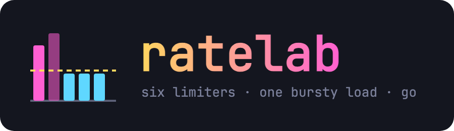
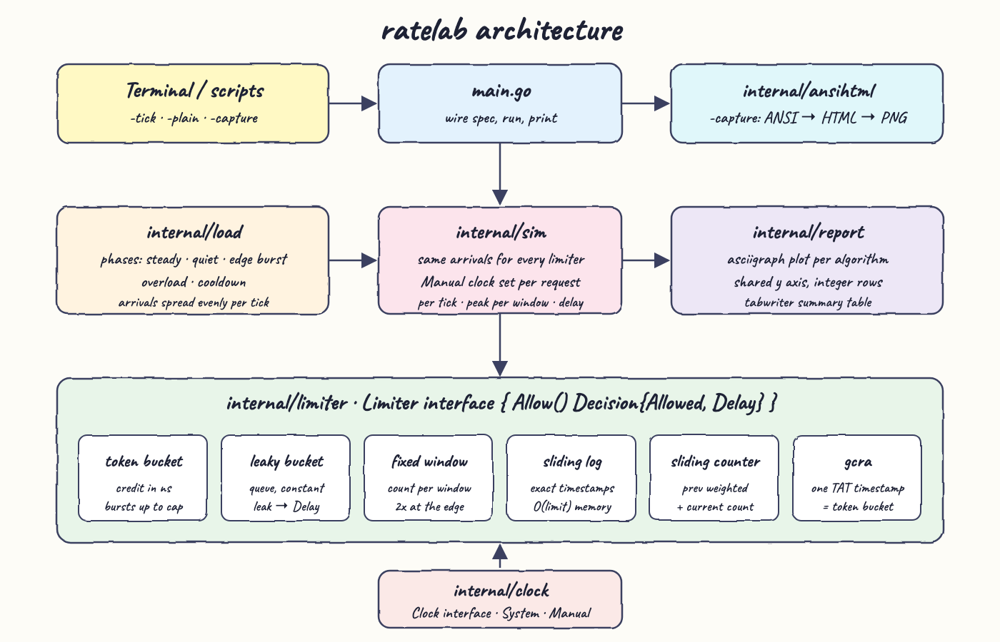
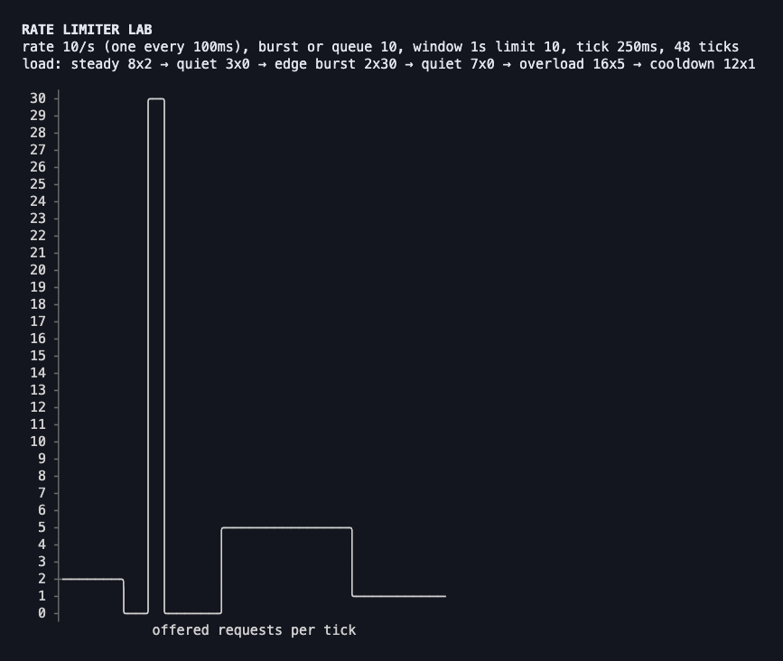
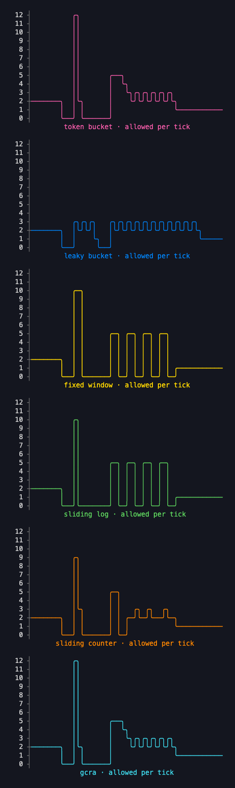
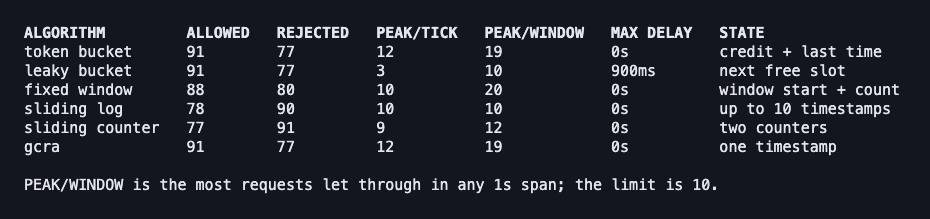

<p align="center"></p>

# rate-limiter-lab

`ratelab` implements six rate limiting algorithms from scratch behind one `Limiter` interface with an injected clock: token bucket, leaky bucket, fixed window, sliding window log, sliding window counter and GCRA. A simulator drives all of them with the same bursty load in virtual time, plots the requests allowed per tick for each with [asciigraph](https://github.com/guptarohit/asciigraph) and prints a summary table. Fixed window is included as the baseline that shows why sliding windows exist.

## How it Works

1. `internal/load` describes the load as phases (steady, quiet, edge burst, overload, cooldown) and spreads each tick's requests evenly inside the tick, so the timing is deterministic.
2. The edge burst covers the last tick of one 1s window and the first tick of the next, on purpose.
3. `internal/sim` builds every algorithm with its own `clock.Manual`, sets the clock to each arrival time and calls `Allow()`.
4. An allowed request runs at `arrival + Decision.Delay`; only the leaky bucket returns a delay, because it queues and leaks at a constant rate.
5. Per algorithm the simulator records runs per tick, allowed, rejected, peak per tick, peak in any window-length span (two pointers over sorted run times) and max delay.
6. `internal/report` draws one asciigraph plot per algorithm on a shared y axis with one row per request, plus a `text/tabwriter` summary.
7. No real time passes: the whole 12 second scenario runs in microseconds and is identical on every run.

## Architecture



The [SVG source](assets/architecture.svg) uses the Caveat font, a wobble filter, pastel boxes and solid arrows.

## Features

- Six algorithms, each in its own file, safe for concurrent callers (mutex per limiter).
- One `Limiter` interface and one `Decision{Allowed, Delay}` result for all of them.
- Injected `clock.Clock`: `clock.System` for real use, `clock.Manual` for tests and the simulator.
- Integer math only (`time.Duration` credit, cross-multiplied weights), so there is no float drift in decisions.
- Bursty load with a window-edge burst, an overload phase and a cooldown.
- Colored asciigraph plot per algorithm, summary table with PEAK/WINDOW to expose boundary effects.
- `-plain` output for files and pipes, `-capture` for printscreens.

## Stack

- Go 1.26
- [github.com/guptarohit/asciigraph](https://github.com/guptarohit/asciigraph) v0.10.0
- Standard library for everything else (`text/tabwriter`, `sync`, `time`)
- Playwright through `npx`, only to turn captured HTML into PNGs

## Contracts

| Flag | Default | Meaning |
|------|---------|---------|
| `-tick` | `250ms` | simulated time per plotted tick (must be positive) |
| `-plain` | `false` | no ANSI colors |
| `-capture` | empty | write each report section as HTML into this folder and exit |

Simulation limits (`sim.DefaultLimits`): rate 10/s (one every 100ms), burst 10 for token bucket and GCRA, queue 10 for leaky bucket, window 1s with limit 10 for the window algorithms.

```go
type Decision struct {
	Allowed bool
	Delay   time.Duration
}

type Limiter interface {
	Allow() Decision
}
```

Constructors return `limiter.ErrInvalidConfig` (wrapped) for zero or negative settings: `NewTokenBucket(clock, every, burst)`, `NewLeakyBucket(clock, every, queue)`, `NewFixedWindow(clock, window, limit)`, `NewSlidingLog(clock, window, limit)`, `NewSlidingCounter(clock, window, limit)`, `NewGCRA(clock, every, burst)`.

## Key data structures and design decisions

| Algorithm | State | Behavior proven by tests |
|-----------|-------|--------------------------|
| token bucket | credit as a `time.Duration` + last time | absorbs a burst up to capacity, refills one token per interval, never banks more than capacity |
| leaky bucket | next free slot time | queues a burst and releases it one interval apart (the delays), rejects when the queue is full, drains over time |
| fixed window | window start + count | resets at the edge: 10 at 0.9s plus 10 at 1.0s means 20 in 100ms, double the limit |
| sliding log | up to `limit` timestamps | never more than the limit in any window, frees a slot exactly one window after each request |
| sliding counter | previous + current counter | weights the previous window, rejects the edge burst; it assumes the previous window was spread evenly, so it allows only 5 where the exact log allows 10 |
| gcra | one theoretical arrival time | same decisions as the token bucket on an irregular sequence, with a single timestamp of state |

- The leaky bucket counts the request in service as part of the queue, so a queue of 10 admits 10 simultaneous requests with delays 0 to 900ms.
- The sliding counter compares `prev*(window-elapsed) + curr*window` with `limit*window`, avoiding floats.
- Windows are aligned with `time.Truncate`, the usual choice for shared counters.
- The simulator test checks every signature on the full scenario: fixed window peaks at 20 per window, sliding log stays at 10, token bucket spends 12 in one tick, the leaky bucket never exceeds 3 per tick, GCRA equals token bucket, only the leaky bucket delays.
- Reading the summary: the sliding counter shows a PEAK/WINDOW of 12, above the limit of 10. That is the cost of its approximation, still far below the fixed window's 20.

## How to run and test

```bash
scripts/setup.sh
scripts/run.sh
scripts/run.sh -tick 500ms
scripts/run.sh -plain > .run/report.txt
scripts/test-all.sh
scripts/printscreens.sh
```

`scripts/run.sh` adds `-plain` when stdout is not a terminal. `scripts/test-all.sh` checks bash syntax, gofmt, go vet, runs `go test -race`, builds, runs the simulation and checks every plot is present, that `-plain` has no escape codes and that `-tick 0` is rejected.

## Printscreens

### 1. Offered load



The parameters and the load every algorithm receives: 2 per tick, a quiet gap, 30 per tick for two ticks across a 1s window edge, a gap, 5 per tick (double the rate) and 1 per tick.

### 2. Allowed per tick



Same y axis for all six. Token bucket and GCRA draw identical lines with a 12 spike (10 saved tokens plus refill). The leaky bucket turns the same burst into a flat 2 to 3 per tick. Fixed window lets 10 through on both sides of the edge; the sliding log lets 10 through once and then nothing until the old requests leave the window; the sliding counter sits in between.

### 3. Summary



Totals per algorithm. PEAK/WINDOW shows the boundary effect: 20 for the fixed window against 10 for the sliding log. MAX DELAY is only non-zero for the leaky bucket, the price of its smoothing. STATE shows how much memory each algorithm keeps per key.
