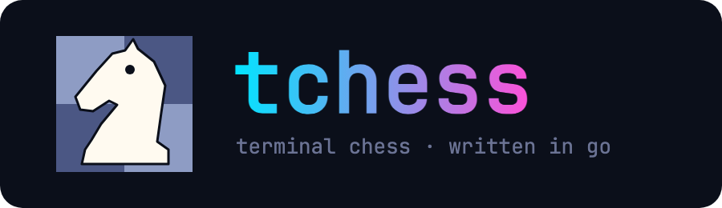
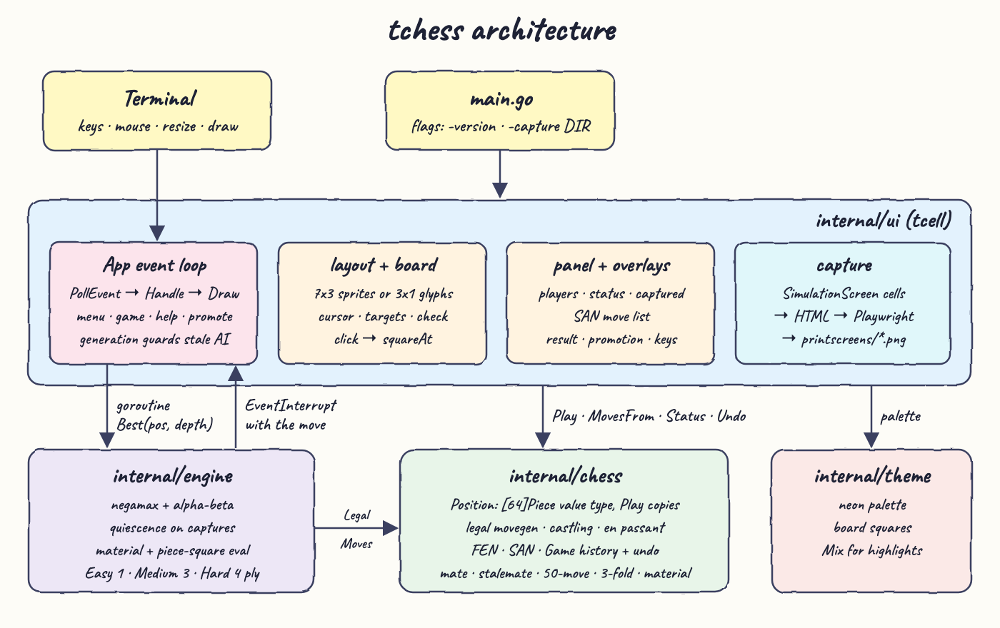
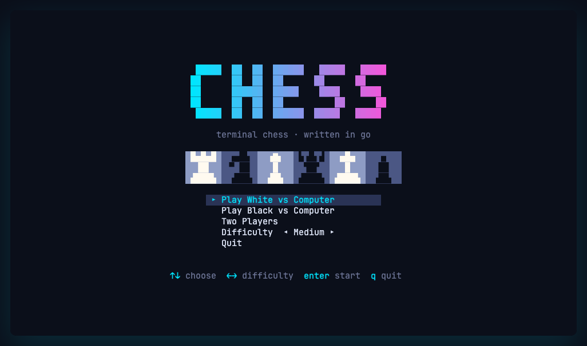
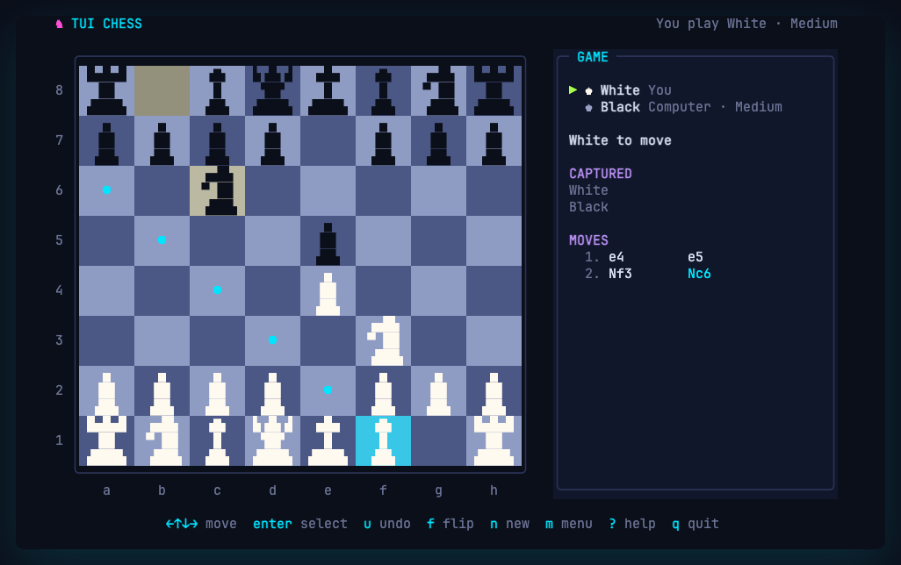
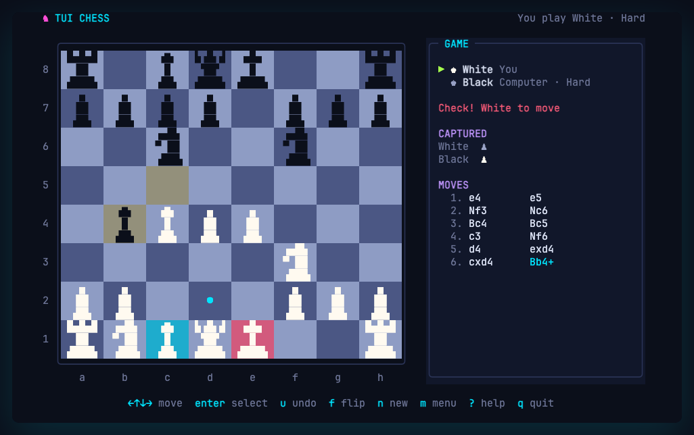
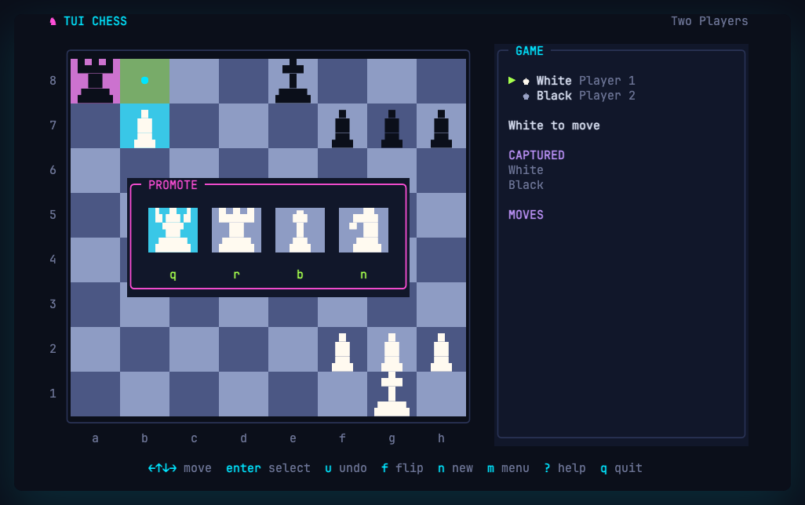
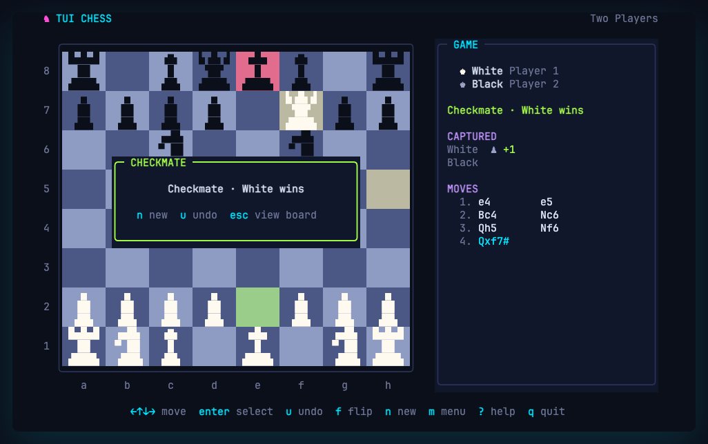
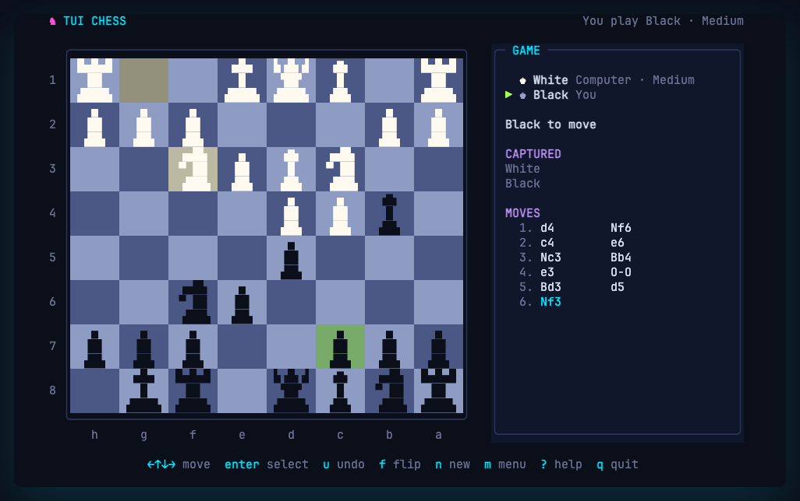
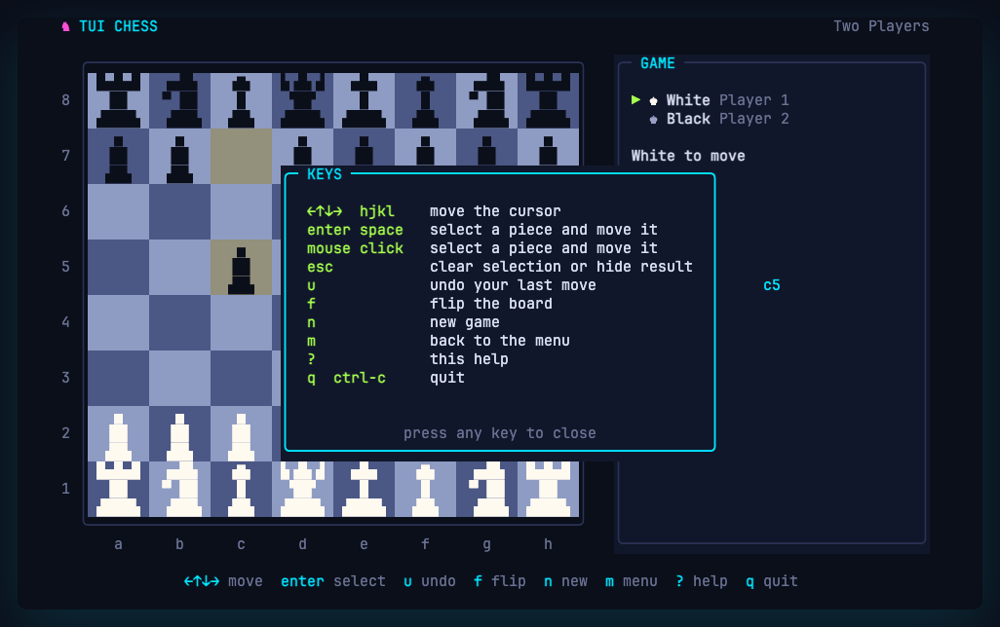
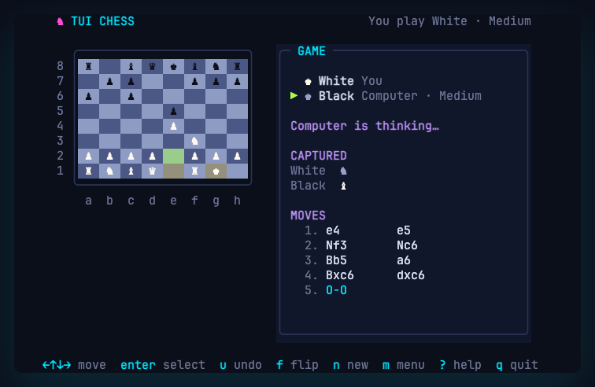

<p align="center"></p>

`tchess` is a chess game for the terminal, written in Go. Play against the computer on three difficulty levels, or with a friend on the same keyboard. The pieces are drawn as block-character sprites in a neon theme. Use the arrow keys or the mouse. It ships as one binary with a single dependency (`tcell`).

## How it Works?

- `main.go` reads the flags. With no flag it opens the TUI; `-capture DIR` renders HTML screens for this README; `-version` prints the version.
- The `ui.App` loop is simple: `PollEvent → Handle → Draw → Show`. Only this goroutine changes game state.
- `internal/chess` holds the rules. A `Position` is a value type (`[64]Piece` plus side to move, castling rights, en passant square and clocks). `Play` returns a new copy, so undo, search and legality checks never have to reverse a move.
- Legal moves are made by generating pseudo-legal moves, playing each one, and dropping the ones that leave your own king attacked.
- `Game` keeps every position, move and SAN string. From that history it reports checkmate, stalemate, the fifty-move rule, threefold repetition and insufficient material.
- On the computer's turn, the app copies the position into a goroutine running `engine.Best`. The move comes back as a `tcell.EventInterrupt`.
- Every search has a generation number. Undo, new game or menu bumps it, so a late reply for an old position is thrown away.
- The layout checks the terminal size on every draw. It uses large 7x3 sprites when they fit and 3x1 Unicode glyphs when they don't (80x24 still works). Clicks use the same layout math, so a click always hits the square that is drawn.

## Architecture



The [SVG source](assets/architecture.svg) uses the Caveat font, a wobble filter, pastel boxes and solid arrows.

## Features

- **Play vs the computer as White or Black:** the board flips for Black so your pieces stay at the bottom.
- **Three difficulty levels:** Easy (1 ply), Medium (3 ply) and Hard (4 ply). Every level adds a capture-only quiescence search, so it will not walk into a simple recapture.
- **Two players:** hot-seat mode on one terminal, for playing a friend.
- **Full chess rules:** castling, en passant, promotion with a piece picker, check, checkmate, stalemate, fifty-move rule, threefold repetition and insufficient material.
- **Keyboard and mouse:** arrows or `hjkl` plus `enter`, or just click. Use whichever you like.
- **Visual hints:** selected piece in cyan, legal moves as dots, capture targets in magenta, last move in yellow, king in check in red, cursor in lime.
- **Side panel:** whose turn it is, status, captured pieces with material lead (`+3`), and a scrolling SAN move list.
- **Undo:** against the computer it takes back your move and the reply together, so it is your turn again.
- **Flip, new game, menu and help:** `f`, `n`, `m`, `?`.
- **Adaptive layout:** big sprites on large terminals, compact glyphs on 80x24, and a "resize to at least" message when even that does not fit.
- **Splash menu:** a gradient `CHESS` banner and a row of piece sprites.
- **macOS install:** `scripts/install-macos.sh` builds `tchess` and installs it into `~/.local/bin`, adding that folder to `PATH` if needed.

## Stack

- **Go 1.26:** one static binary, fast enough for a 4-ply search in a fraction of a second.
- **tcell v2:** raw terminal cells, 24-bit color, mouse events, and a simulation screen used for tests and captures.
- **Go standard library:** everything else. The rules, engine, FEN/SAN and HTML capture have no other dependencies.
- **Playwright (npx):** only used to turn the captured HTML screens into the PNGs below.

## Contracts

`tchess` has no network API. Its contract is the command line and the keys.

| Flag | What it does |
|---|---|
| `tchess` | Opens the TUI |
| `tchess -version` | Prints `tchess 1.0.0` |
| `tchess -capture DIR` | Writes one HTML page per screen into `DIR` and exits |

| Key | Action |
|---|---|
| `←↑↓→` `hjkl` | Move the cursor |
| `enter` `space` / mouse click | Select a piece, then move it |
| `esc` | Clear the selection or hide the result |
| `q` `r` `b` `n` | Pick the promotion piece |
| `u` | Undo |
| `f` | Flip the board |
| `n` | New game |
| `m` | Menu |
| `?` | Help |
| `q` `ctrl-c` | Quit |

Go packages:

| Package | Public surface |
|---|---|
| `internal/chess` | `ParseFEN`, `Position.LegalMoves/Play/SAN/InCheck/FEN`, `NewGame`, `FromFEN`, `Game.Play/Undo/Status/Captured/SANs/MovesFrom` |
| `internal/engine` | `Best(pos, depth) (Move, bool)`, `Evaluate(*Position) int`, `Levels` |
| `internal/ui` | `Run() error`, `Capture(dir) error`, `New(screen)`, `App.Handle/Draw` |
| `internal/theme` | Palette constants, `Color(hex)`, `Mix(a, b, t)` |

## Key data structures and design decisions

- **`Position` is a value, not a pointer graph:** 64 small `Piece` structs plus turn, castling, en passant and clocks. Copying it avoids make/unmake bookkeeping, and it makes the engine goroutine safe without locks: it gets its own copy.
- **Legal moves = pseudo-legal moves + "is my king attacked after this move":** simple, and verified with **perft** node counts on five reference positions (start, Kiwipete, en passant discovered check, promotions, and the TalkChess bug catcher). A wrong castle or en passant rule changes those counts.
- **Castling rights drop through `rightsLostAt(square)`:** any move from or to a1, h1, e1, a8, h8 or e8 clears the matching rights. Rook captures and king moves need no special cases.
- **En passant square is set only when an enemy pawn can capture:** positions that differ only in a useless en passant square count as the same position, so threefold repetition is counted correctly.
- **Engine:** negamax with alpha-beta, MVV-LVA move ordering, and a quiescence search limited to captures and promotions. Mate scores include the ply, so the shortest mate wins. The evaluation is material plus piece-square tables, with a king endgame table once officers drop below 1300 cp.
- **UI state is one struct and one goroutine:** only the engine runs elsewhere, and its reply comes back as an event. A `generation` counter replaces cancellation.
- **One layout function** decides both where squares are drawn and which square a click hits. A test checks this for every square, both sizes and both orientations.
- **Captures are real renders:** `-capture` draws the real `App` into a `tcell.SimulationScreen` and writes each cell's rune and colors as HTML. The screenshots are the actual TUI, not mockups.

## How to run

```bash
./scripts/setup.sh
./bin/tchess
```

Install on macOS (builds and copies `tchess` into `~/.local/bin`; set `TCHESS_INSTALL_DIR` to change it):

```bash
./scripts/install-macos.sh
tchess
./scripts/uninstall-macos.sh
```

Tests (bash syntax, gofmt, go vet, 31 unit tests with `-race`, then a build and a `-version` smoke run):

```bash
./scripts/test-all.sh
```

```
bash syntax
gofmt
go vet
unit tests
?   	github.com/diegopacheco/tui-chess	[no test files]
ok  	github.com/diegopacheco/tui-chess/internal/chess	2.717s
ok  	github.com/diegopacheco/tui-chess/internal/engine	5.521s
?   	github.com/diegopacheco/tui-chess/internal/theme	[no test files]
ok  	github.com/diegopacheco/tui-chess/internal/ui	1.689s
building bin/tchess
all tests passed
```

- `internal/chess`: perft counts, FEN round trip and rejection, fool's mate, stalemate, pins, castling through check, en passant, under-promotion, SAN disambiguation, repetition, fifty-move rule, insufficient material, undo.
- `internal/engine`: every level finds mate in one and takes a hanging queen; deeper levels avoid a poisoned capture and defend against scholar's mate; no move in stalemate; symmetric evaluation; Hard answers in under 5 seconds.
- `internal/ui`: clicks map to the drawn square, flipped orientation, two players moving by mouse, you cannot select opponent pieces, keyboard promotion, no input during the computer's turn, undo gives the turn back, stale engine replies are dropped, every capture renders.

## Printscreens

Regenerate them with `./scripts/printscreens.sh` (runs `tchess -capture` and then Playwright).

### Menu



The start screen: a gradient `CHESS` banner and a row of piece sprites. Pick a side against the computer, two players, or the difficulty (`←→` changes it).

### Selecting a piece



After `1.e4 e5 2.Nf3 Nc6`, the f1 bishop is selected (cyan). Cyan dots show its legal squares. The last move `Nc6` is highlighted in yellow on b8 and c6, and the panel shows it is White's turn.

### Check



Black played `6...Bb4+`. The white king on e1 turns red, the status reads "Check! White to move", and with the c1 bishop selected only `Bd2` is offered: pieces that cannot stop the check get no moves. The captured row shows pawns traded on d4.

### Promotion



The b7 pawn moves to b8 and the promotion picker opens over the board. Queen is selected; `q r b n` or `←→` + `enter` picks the piece. The a8 rook stays magenta because capturing it with a promotion is also legal.

### Checkmate



Scholar's mate in two-player mode. `Qxf7#` ends the game, the black king is red, and the result box offers new game, undo, or `esc` to hide the box and look at the final position.

### Playing Black



Playing Black against the computer: the board is flipped (rank 8 at the bottom, files h to a), the panel says "You" next to Black, and the computer's last move `Nf3` is highlighted.

### Help



`?` opens the key reference over the game. Any key closes it.

### Compact terminal (80x24)



On a standard 80x24 terminal the board switches to Unicode glyphs so the side panel still fits. Here White just castled and the computer is thinking.

## Scripts

All scripts live in `scripts/` and run from any directory of the repository. `tchess` is a local TUI with no services or ports, so there are no start, stop, status, ui or sql-console scripts.

| Script | What it does |
|---|---|
| `./scripts/setup.sh` | Downloads Go modules and builds `bin/tchess` |
| `./scripts/test-all.sh` | Bash syntax, gofmt, go vet, unit tests with `-race`, build and smoke run |
| `./scripts/install-macos.sh` | Builds and installs `tchess` into `~/.local/bin` (or `TCHESS_INSTALL_DIR`) and adds it to `PATH` |
| `./scripts/uninstall-macos.sh` | Removes the installed `tchess` |
| `./scripts/printscreens.sh` | Renders every screen with `tchess -capture` and screenshots it into `printscreens/` |

```bash
./scripts/setup.sh
./scripts/test-all.sh
./scripts/install-macos.sh
tchess
```
