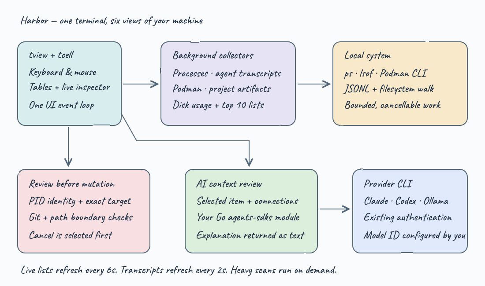
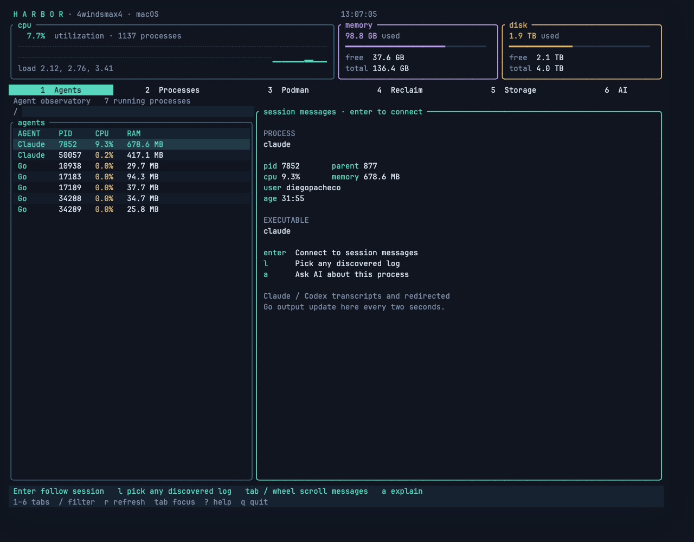
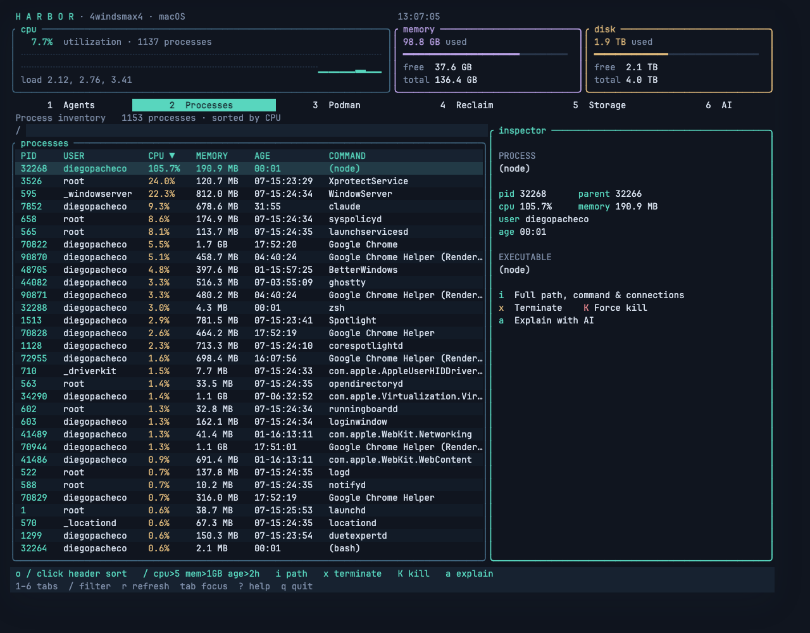
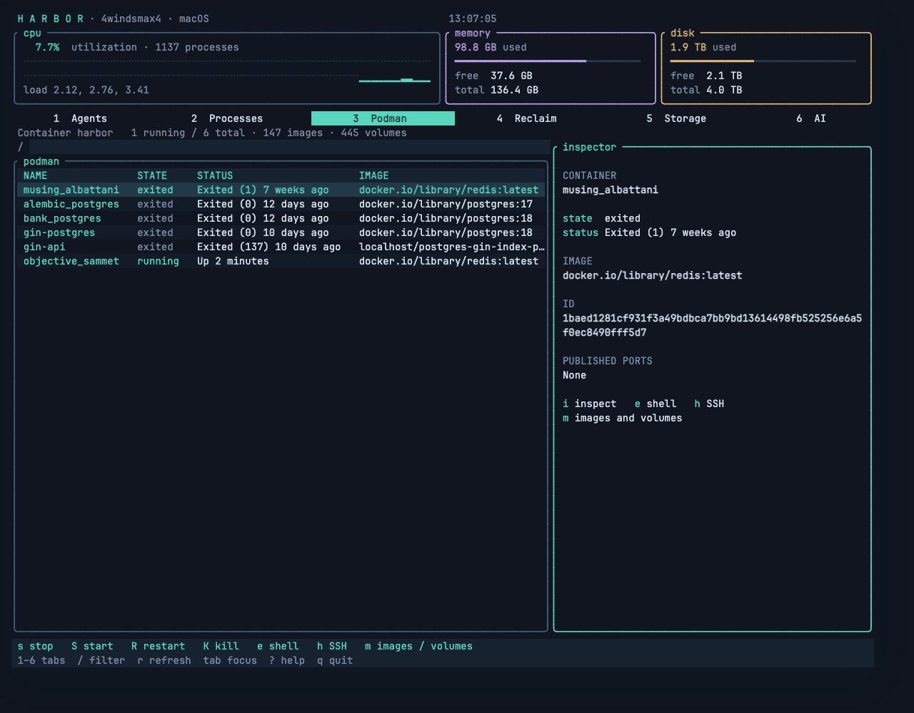
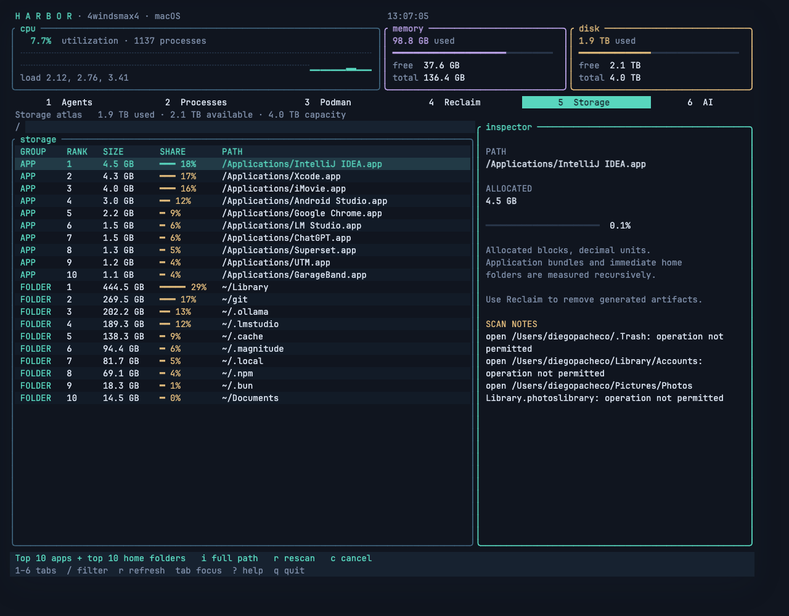
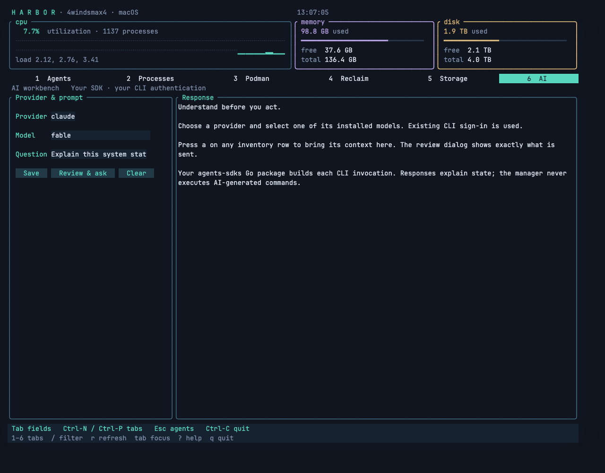

<p align="center"></p>

Harbor is a btop-inspired Go TUI for managing a macOS development machine. Six mouse-enabled tabs bring agent sessions, processes, Podman, build cleanup, storage usage, and your local AI SDK into one terminal. Its dark interface uses compact bordered panels, live CPU history, memory/disk meters, and side-by-side inventories and inspectors.

## How it Works?

Harbor collects local state in background workers and updates a single terminal event loop.
One long-running `top` sampler streams CPU, memory, and volume panels every two seconds, even under full CPU load; if it exits, the last graph stays visible while it restarts.
Process and Podman inventories refresh every six seconds while their tab is active.
Selecting an agent opens its readable transcript or lets you choose a matching log; messages refresh every two seconds.
Project and storage scans run when opened, with progress reporting and cancellation.
Every destructive action first presents the exact target, with Cancel selected.
Cleanup verifies project markers, scan boundaries, symbolic links, and Git-tracked files before deleting artifacts.
AI sends a reviewed snapshot through your Go SDK and returns an explanation as text.

## Features

- **Agents:** Claude, Codex, Go commands, and Go binaries; Enter follows the session, `l` picks from every discovered log, and you can scroll back without being pulled to the bottom.
- **Processes:** Sort by CPU, memory, or age and filter with `cpu>5 mem>1GB age>2h`; the inspector shows full paths and connections; terminate or force-kill with confirmation.
- **Podman:** Containers (start/stop/restart/kill, shell, SSH), images, and volumes; images and volumes can be force-deleted even when exited containers use them.
- **Reclaim:** Recursively scan `~/git/diegopacheco`, rank generated artifacts per project in decimal kB/MB/GB/TB, and delete the safe ones; the list updates immediately.
- **Storage:** Volume capacity and available space, ten largest application bundles, and ten largest immediate home folders measured recursively.
- **AI:** Claude, Codex, and Ollama through your existing Go SDK; models are selected from a list discovered on this machine, with selected-item context and a CLI question mode.

## Architecture



The [SVG source](assets/architecture.svg) embeds the Caveat font, pastel boxes, a wobble filter, and solid connecting paths. Terminal widgets call focused Go collectors; only the UI event loop mutates displayed state. Workers use cancellable contexts and bounded command output.

## Stack

- **Go 1.26:** Standard-library process execution, JSON parsing, filesystem walking, cancellation, tests, and file locking.
- **tview + tcell:** Terminal tables, forms, mouse input, Unicode rendering, and simulation-screen verification.
- **Your Go agent SDK:** `github.com/diegopacheco/agent-sdk-go/agent` provides the provider constructors and CLI argument builders.
- **macOS command-line tools:** `top`, `ps`, `lsof`, Git, SSH, and Podman provide local system information and explicit controls.
- **Playwright via npx:** Captures the actual tcell-rendered screen cells for documentation; it is not an application runtime dependency.

## Source layout

All Go source and tests live in `src/`; `go.mod` and `go.sum` remain at the project root.

| Path | Responsibility |
|---|---|
| `src/main.go`, `src/lifecycle.go` | CLI entry point, instance lock, status and stop |
| `src/ui.go`, `src/dashboard.go` | Six tabs, keyboard/mouse controls, btop-style panels and selection previews |
| `src/metrics.go`, `src/system.go`, `src/filter.go` | CPU/memory samples, processes, Podman, and process filters/sorting |
| `src/storage.go`, `src/sessions.go` | Filesystem sizing, cleanup protections and transcript following |
| `src/ai.go`, `src/capture.go` | Your SDK integration and terminal screen capture |
| `src/*_test.go` | Behavior, safety and UI regression tests |
| `scripts/` | Build, run, test, install and uninstall commands |

The direct build command is `go build -o bin/harbor ./src`.

## How to run the app/tests

Keep this project in `~/git/diegopacheco/go-playground/tui-prod-manager-macos` and your SDK in `~/git/diegopacheco/personal-private-software/agents-sdks/go`. The requested SDK directory was found under the plural name `agents-sdks`.

```bash
./scripts/setup.sh
./scripts/start-all.sh
```

Use a UTF-8 terminal with at least 100 columns and 32 rows for comfortable inspection. Mouse support is enabled. Smaller terminals render with truncated table columns; the inspector shows complete paths.

```bash
./bin/harbor --root "$HOME/git/diegopacheco"
./scripts/test-all.sh
./scripts/install.sh
harbor
./scripts/uninstall.sh
```

Installation removes the previous managed binary, rebuilds, and installs one `harbor` executable in `~/.local/bin`. A file lock prevents concurrent UI instances. `HARBOR_INSTALL_DIR` overrides the installation directory; keep one installation directory in use. Configuration survives uninstall.

For a different SDK checkout, set its absolute Go module directory before setup:

```bash
HARBOR_SDK_ROOT="$HOME/git/diegopacheco/personal-private-software/agents-sdks/go" ./scripts/setup.sh
```

This updates the local module replacement in `go.mod`. The private SDK is a build dependency; it is not copied into this repository. Podman and AI CLIs are optional for opening Harbor; unavailable integrations report their errors in the inspector. Start your Podman machine separately if needed.

## Controls

| Area | Keys |
|---|---|
| Navigation | `1`–`6` or click a tab; `Ctrl-N` / `Ctrl-P` move between tabs |
| Inventory | Arrows or `j` / `k` select; `Enter` or `i` inspect; `/` filters by text |
| Inspector | `Tab` moves focus; mouse wheel, arrows and Page Up/Down scroll; `End` resumes live messages; `Esc` returns to inventory |
| Refresh | `r` refreshes; `c` cancels the current collector |
| Agents | `Enter` follows the session's transcript or log; `l` lists every discovered log to pick from |
| Processes | `o` or clicking CPU/MEMORY/AGE sorts; `/cpu>5 mem>1GB age>2h` filters (`>`, `<`, `>=`, `<=`; units kB/MB/GB, s/m/h/d); `x` SIGTERM; `K` SIGKILL |
| Podman | `s` stop, `S` start, `R` restart, `K` kill, `e` shell, `h` SSH; `m` cycles containers → images → volumes |
| Images / Volumes | `d` force-deletes the selected image (and containers using it) or volume |
| Reclaim | `d` reviews and deletes artifacts for the selected project |
| Confirmations | Red dialog with `Cancel` focused; press `y` or `Tab` to Confirm; `Esc` / `n` cancel |
| Status line | Every key reports in the footer: ⟳ running with elapsed seconds, ✔ done, ✖ failed, › cancelled or not applicable |
| AI | `a` brings the selected item to AI; `Tab` moves through provider, model list, and question |
| General | `?` help; `q` or `Ctrl-C` exits; use `Ctrl-C` while typing in AI |

SSH requires an SSH server inside the container, TCP port 22 published to the host, and valid credentials. `e` uses `podman exec -it CONTAINER /bin/sh`, which works without an SSH server when the image contains a shell. Host key verification remains enabled.

## Contracts/APIs

Harbor is a terminal executable with no HTTP server, public network listener, or database.

| Interface | Contract |
|---|---|
| `harbor --root PATH` | Override the project cleanup scan root |
| `harbor --status` | Print the managed UI state and PID |
| `harbor --stop` | Stop only the matching locked Harbor instance |
| `harbor --version` | Print the installed version |
| `harbor --ask TEXT --provider NAME --model ID` | Ask a general systems question through the SDK and print the response |
| `harbor --capture DIRECTORY` | Read local inventories and export six HTML views of actual terminal cells |
| SDK `Call(model, prompt, args)` | Return provider text or a surfaced command error |
| Configuration | `${XDG_CONFIG_HOME:-~/.config}/harbor/config.json`, mode `0600` |
| Instance lock | `instance.lock` alongside configuration; contains PID and start identity |

Configuration contains only `provider` and `model`. Tab 6 lists models for the chosen provider: Claude aliases and IDs, Codex models from `~/.codex/models_cache.json`, and installed Ollama models from `ollama list`. Authentication stays with the installed provider CLI.

```bash
harbor --ask 'What is a process ID?' --provider claude --model sonnet
```

The TUI previews the question and context before calling a provider. A process snapshot can contain its path, user, PID, and `lsof` connection data. A container snapshot can contain image metadata, published ports, network settings, and its process list. Environment variables and transcript contents are not automatically added to AI context. Claude runs with tools and MCP servers disabled; Codex uses its read-only sandbox and ignores user configuration/rules; Ollama receives a text prompt. Provider requests have a 90-second limit. The manager never executes returned commands.

## Key data structures and design decisions

| Structure | Purpose |
|---|---|
| `Process` | Stable PID selection, CPU/RSS inventory, and full executable path |
| `Container` / `Image` / `Volume` | Typed Podman JSON results; operations use IDs or volume names instead of display labels |
| `Project` / `Candidate` | A project total plus every generated directory included in a cleanup review |
| `Storage` / `DiskEntry` | Capacity, ranked app/folder allocations, and visible scan warnings |
| `LogSource` | A discovered transcript or log path, label, modification time, and whether it is linked to the PID |
| `AIConfig` | Provider and model without copied credentials |
| `UI` | Event-loop-owned state; worker results return through queued updates |

Commands use argument arrays rather than shell interpolation. Before signaling a process, Harbor checks its start identity again to reduce PID reuse mistakes and refuses init, itself, and its parent. This is a best-effort macOS check; PID signaling cannot be made atomic with the preceding identity lookup.

Cleanup accepts `node_modules`, `dist`, and `.next` alongside `package.json`; `target` alongside Maven, SBT, Mill, or Cargo markers; and `build` alongside Gradle or CMake markers. It skips nested candidates to avoid counting the same subtree twice. Each candidate is checked right before deletion; folders with Git-tracked files, symbolic links, or unverifiable Git ownership are kept and listed with the reason, without blocking the safe folders. Deleted and already-missing folders leave the list immediately. Each directory is renamed into a temporary sibling before removal. Stop builds using those paths first. Failed removals report where remaining files are located.

Sizes count allocated blocks, with decimal units. APFS clones, snapshots, hard links, shared volumes, and concurrent changes mean measured artifacts do not guarantee an identical increase in available disk space. Top-folder ranking covers immediate home directories, including hidden ones; application ranking covers `/Applications`, `/System/Applications`, and `~/Applications`. Access failures and five-minute scan deadlines produce explicitly partial results.

Log discovery needs no typed path. Enter follows the first PID-linked source: the Claude session transcript, a stdout/stderr file, or an open `.log`/`.jsonl`/`.out` file. `l` also offers `*.log` files in the process working directory, Claude/Codex transcripts with the same working directory, and recent transcripts, all marked as unconfirmed. Another terminal's existing output cannot be recovered from its PTY, so a Go program writing only to a terminal needs its output redirected to a `.log` file. New messages never move a reader who scrolled up; `End` or scrolling to the bottom resumes following. Log reads are bounded to the final 256 KiB, and incomplete JSONL records are ignored until complete.

## Verification

`./scripts/test-all.sh` runs the Go suite with the race detector, `go vet`, and Bash syntax checks. Tests cover path boundaries, symlinks, tracked folders kept without blocking safe ones, reclaim list updates, `y` confirmation, source preservation, CPU/memory/age filters and sorting, model lists per provider, log discovery without paths, scroll position during live updates, forced image/volume deletion, cancellation, PID reuse, signaling an owned child, Podman parsing/arguments, SSH requirements, SDK dispatch, configuration permissions, live transcript updates, keyboard/mouse navigation, filtering, confirmation defaults, three terminal sizes, macOS resource parsing, live sample streaming that skips the since-boot average, sampler failure recovery, and measured CPU history.

Host checks also exercise read-only process/Podman inventories, the start/status/duplicate-start/stop lifecycle, and a successful Claude request through the Go SDK. Tests never stop your existing containers or delete your existing project artifacts.

## Printscreens

These captures render real tcell screen contents collected from this machine, then photograph those HTML terminal-cell renders using `npx playwright`. They are static documentation captures, not a browser-based version of Harbor. They include machine-specific paths and inventory state; quantities change as processes and disk contents change.

### 1. Agents

Claude, Codex, and Go processes with CPU, memory, age, and executable paths. Select a row to choose a transcript and follow new messages in the inspector.



### 2. Processes

The inventory is sorted by the column marked ▼ (CPU, memory, or age) and keeps selection attached to its PID across refreshes. The adjacent inspector previews full paths and key process facts; `i` loads working directory and connection details.



### 3. Podman

Container states and image names are visible together, and the summary counts images and volumes. The footer exposes lifecycle controls, shell/SSH access, and `m`, which cycles to the image and volume lists.



### 4. Storage

Volume usage accompanies the ranked application and home-folder lists. Scroll the inventory to reach all twenty entries. Warnings identify inaccessible or incomplete measurements.



### 5. AI

Choose a provider, pick a model from the discovered list, edit a question, and review selected-item context before submitting it through your SDK.



To recreate the captures:

```bash
./bin/harbor --capture printscreens
for page in printscreens/*.html; do
  npx playwright screenshot --browser chromium --viewport-size '1280,1000' --full-page "file://$PWD/$page" "${page%.html}.png"
done
```

For repeated visual checks, set `HARBOR_CAPTURE_STATE` to a local JSON path. The first capture saves its collected inventory there; subsequent captures replay that snapshot without repeating disk scans. Remove the snapshot to collect fresh data.

## Scripts

All scripts run from any working directory. This is an interactive terminal application, so it has no service ports, browser runtime, or SQL console.

| Script | Purpose |
|---|---|
| `./scripts/setup.sh` | Check the SDK, fetch Go dependencies, and build `bin/harbor` |
| `./scripts/start-all.sh` | Launch the TUI in the current terminal or report the running instance |
| `./scripts/stop-all.sh` | Stop the verified manager instance and wait for its lock to release |
| `./scripts/status.sh` | Print UP/DOWN and the manager PID when running |
| `./scripts/test-all.sh` | Run race-enabled tests, vet, and Bash checks |
| `./scripts/ui.sh` | Open the terminal interface |
| `./scripts/install.sh` | Uninstall, rebuild, and install the managed executable |
| `./scripts/uninstall.sh` | Stop and remove the managed executable while preserving settings |

The terminal layout is inspired by [btop](https://github.com/aristocratos/btop). Terminal widgets follow the [tview API](https://pkg.go.dev/github.com/rivo/tview). Container shells follow the [Podman exec contract](https://docs.podman.io/en/latest/markdown/podman-exec.1.html). The diagram font is distributed under its [OFL license](assets/Caveat-OFL.txt).
