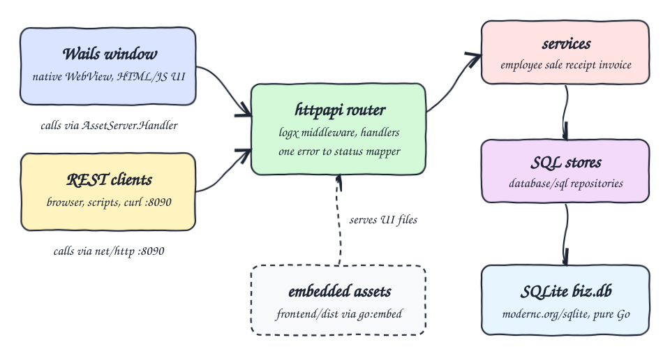
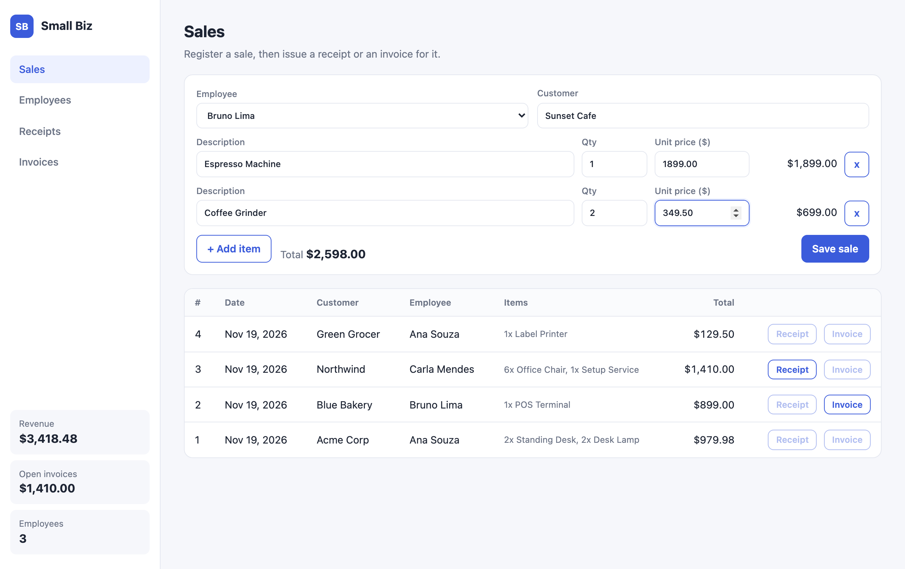
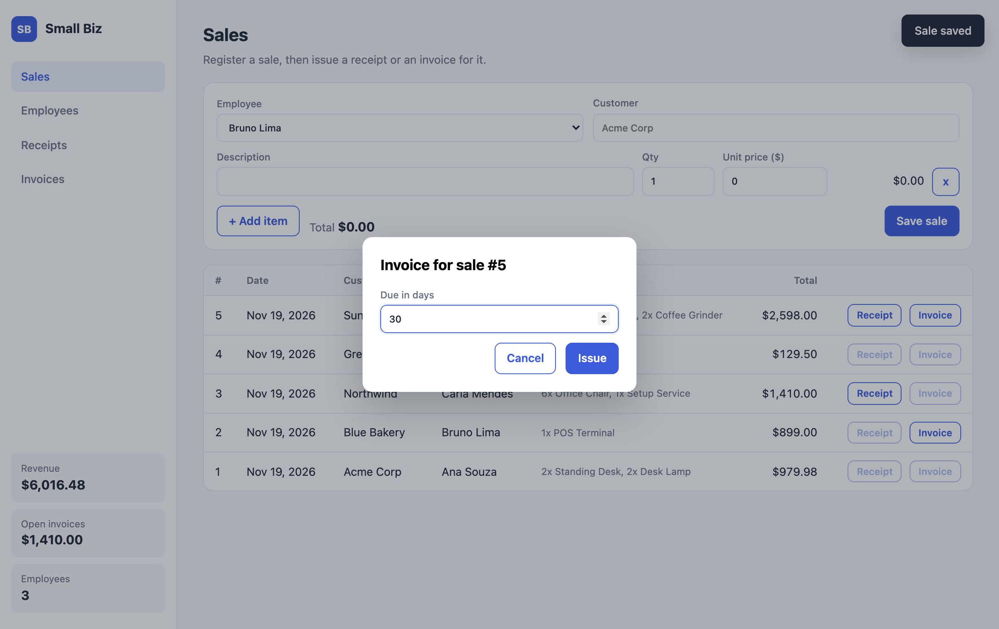
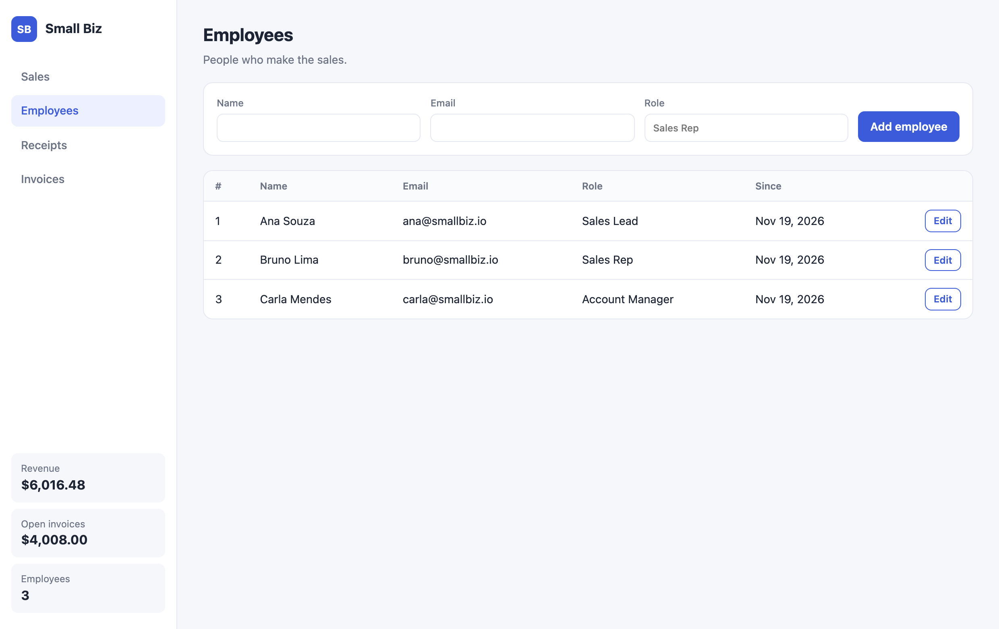
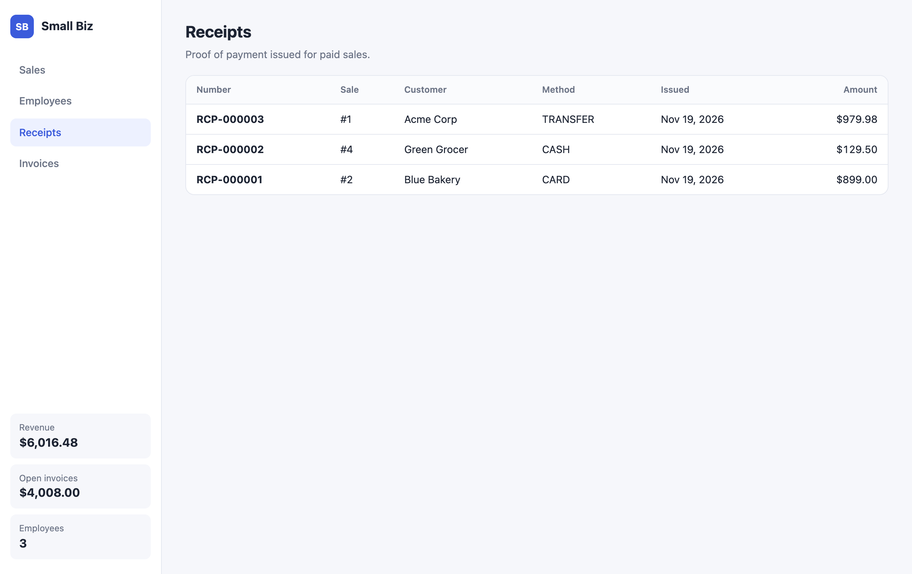
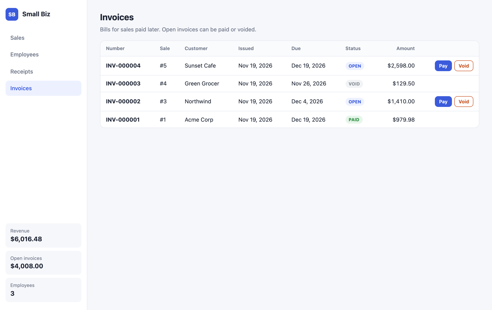

# Small Biz Manager (wails-fun)

A small business desktop app built with Go and [Wails](https://wails.io). It manages **employees**, **sales**, **sales receipts** and **invoices**, keeps everything in a local **SQLite** database, and exposes the same features as a **REST API**.

## Wails: Electron for Go

Wails builds native desktop apps in Go. The UI is HTML, CSS and JS rendered by the operating system's built-in WebView: WKWebView on macOS, WebView2 on Windows, WebKitGTK on Linux. Think of it as Electron with Go in place of Node.js, but lighter.

| | Wails | Electron |
|---|---|---|
| Backend language | Go, compiled, same process | Node.js |
| UI | HTML/CSS/JS in the system WebView | HTML/CSS/JS in bundled Chromium |
| App size | a few MB | 100+ MB |
| Rendering | can differ slightly per OS | identical everywhere |

## How it Works

1. `main.go` opens the SQLite database, runs the schema migration and wires stores, services and the HTTP router.
2. The same `net/http` router is served two ways: on `127.0.0.1:8090` for REST clients, and inside the Wails window through `AssetServer.Handler`.
3. The UI is plain HTML, CSS and JS in `frontend/dist`, embedded in the binary with `go:embed`. No npm and no build step.
4. The UI calls `/api/...` with `fetch`. In the Wails window those calls never leave the process; in a browser they go to port 8090.
5. Handlers decode JSON and call a service. Services hold the rules: totals, validation, numbering, invoice status transitions.
6. Stores are the only code that touches `database/sql`.
7. Errors from any layer are mapped to HTTP status codes in one place (`httpapi/json.go`).
8. Every request gets an `X-Correlation-Id` that shows up in the JSON logs.

## Architecture



## Features

* **Employees**: add and edit staff; emails are normalized and unique so the same person cannot be added twice.
* **Sales**: multi-item sales tied to an employee; the server computes the total so the client cannot tamper with it.
* **Receipts**: proof of payment for a sale (cash, card or transfer), numbered `RCP-000001`, one per sale.
* **Invoices**: bill a sale with a due date (1 to 90 days), numbered `INV-000001`, one per sale.
* **Invoice lifecycle**: `OPEN` can become `PAID` or `VOID`, nothing else, so revenue is never counted twice.
* **Overdue flag**: open invoices past the due date are flagged so you know who to collect from.
* **Sidebar KPIs**: revenue, open invoice amount and head count at a glance.
* **Headless mode**: `BIZ_HEADLESS=true` runs only the REST API and web UI, useful for servers and UI tests.

## Stack

* **Go 1.26**: one static binary for UI host, API and database access.
* **Wails v2.17.1**: native desktop window using the OS WebView, much lighter than Electron.
* **net/http ServeMux**: method and path patterns from the standard library, no router dependency.
* **SQLite via modernc.org/sqlite**: pure Go driver, no CGO for the database, single file storage.
* **log/slog**: structured JSON logs with correlation id, path and service name.
* **Vanilla HTML/CSS/JS**: zero frontend dependencies and no build step.

## REST API

Base URL: `http://localhost:8090/api`. Money is always in integer cents. Errors return `{"error": "..."}`.

| Method | Path | Body | Result |
|---|---|---|---|
| GET | `/employees` | | list employees |
| POST | `/employees` | `{"name","email","role"}` | 201 employee, 409 duplicate email |
| GET | `/employees/{id}` | | employee, 404 |
| PUT | `/employees/{id}` | `{"name","email","role"}` | updated employee |
| GET | `/sales` | | list sales with items |
| POST | `/sales` | `{"employeeId","customer","items":[{"description","quantity","unitPriceCents"}]}` | 201 sale with computed `totalCents` |
| GET | `/sales/{id}` | | sale, 404 |
| GET | `/receipts` | | list receipts |
| POST | `/receipts` | `{"saleId","method":"CASH\|CARD\|TRANSFER"}` | 201 receipt, 409 if the sale has one |
| GET | `/invoices` | | list invoices with `overdue` |
| POST | `/invoices` | `{"saleId","dueDays"}` | 201 invoice, 409 if the sale has one |
| POST | `/invoices/{id}/pay` | | invoice `PAID`, 409 if not open |
| POST | `/invoices/{id}/void` | | invoice `VOID`, 409 if not open |

Status codes: `400` invalid input, `404` not found, `409` conflict, `500` internal error.

## Key Data Structures and Design Decisions

* **Tables**: `employees`, `sales`, `sale_items`, `receipts`, `invoices`. `receipts.sale_id` and `invoices.sale_id` are `UNIQUE`, so the database itself guarantees one document of each kind per sale.
* **`money.Cents` (int64)**: money never uses floats, so totals never drift by a cent.
* **Typed enums**: `receipt.Method` and `invoice.Status` are string types with fixed constants.
* **Numbers derived from ids**: `RCP-%06d` and `INV-%06d` are computed from the row id, so they are unique and gapless without extra state.
* **Consumer defined interfaces**: services depend on small interfaces (`store`, `saleGetter`, `employeeGetter`); the router depends on service interfaces. Tests swap in real SQLite in a temp dir.
* **Injected clock**: services take `func() time.Time`, so due dates and overdue checks are deterministic in tests.
* **Sentinel errors** in `apperr` (`ErrNotFound`, `ErrInvalid`, `ErrConflict`) wrapped with context and mapped once to HTTP status.
* **Single owner per concern**: config in `internal/config`, logging in `internal/logx`, one `*sql.DB` opened in `main`.

## Project Layout

```
main.go                 wires everything, starts REST server and Wails window
wails.json              Wails project config
frontend/dist/          index.html, style.css, app.js
internal/config         typed config from env (BIZ_PORT, BIZ_DB, BIZ_HEADLESS)
internal/logx           slog logger and correlation id middleware
internal/apperr         sentinel errors
internal/money          Cents type
internal/db             open SQLite, schema, unique constraint check
internal/employee       model, service, SQL store
internal/sale           model, totals, service, SQL store
internal/receipt        model, numbering, service, SQL store
internal/invoice        model, lifecycle, service, SQL store
internal/httpapi        router, handlers, JSON and error mapping
scripts/                setup, start, stop, status, tests, ui, sql console
```

## How to Run

Requirements: Go 1.26 and macOS (Wails uses the system WebView). `setup.sh` installs the Wails CLI when it is missing.

```bash
./scripts/setup.sh
./scripts/start-all.sh
```

This opens the desktop window and also serves the UI and API at `http://localhost:8090`. To run without a window:

```bash
BIZ_HEADLESS=true ./scripts/start-all.sh
```

Development mode with the Wails CLI:

```bash
wails dev
```

Tests:

```bash
./scripts/test-all.sh
```

The tests cover sale totals and validation, invoice transitions and overdue rules, money formatting, and a full REST flow against a real SQLite file: employee, sale, receipt, invoice, pay, and the 400/404/409 error paths.

## Printscreens

### Sales



A new sale for Sunset Cafe being entered with two items. Line subtotals and the total update while typing. Below is the sales list; the Receipt and Invoice buttons are disabled when the sale already has that document.

### Issue an invoice



After saving, the sale appears as #5. Clicking Invoice opens a dialog asking for the due days; Receipt asks for the payment method instead.

### Employees



Staff list with name, email, role and start date. Edit loads an employee into the form at the top.

### Receipts



Every receipt with its number, sale, customer, payment method and amount taken from the sale total.

### Invoices



Invoices with issue and due dates. Status badges show OPEN, PAID or VOID, and only open invoices offer Pay and Void. The sidebar shows revenue and the open invoice amount.

## Scripts

All scripts live in `scripts/` and run from any directory of the repository.

| Script | What it does |
|---|---|
| `./scripts/setup.sh` | Installs dependencies, the Wails CLI if missing, and builds the app |
| `./scripts/start-all.sh` | Starts the app and prints the full link of each service |
| `./scripts/status.sh` | Shows the app port as UP or DOWN |
| `./scripts/test-all.sh` | Runs go vet and every test suite |
| `./scripts/ui.sh` | Opens the UI in the browser |
| `./scripts/stop-all.sh` | Stops the app |
| `./scripts/sql-console.sh` | Opens a sqlite3 console on the database |

Ports are declared in `scripts/ports.env` (`app=8090`).

```bash
./scripts/setup.sh
./scripts/start-all.sh
./scripts/status.sh
./scripts/ui.sh
./scripts/stop-all.sh
```
